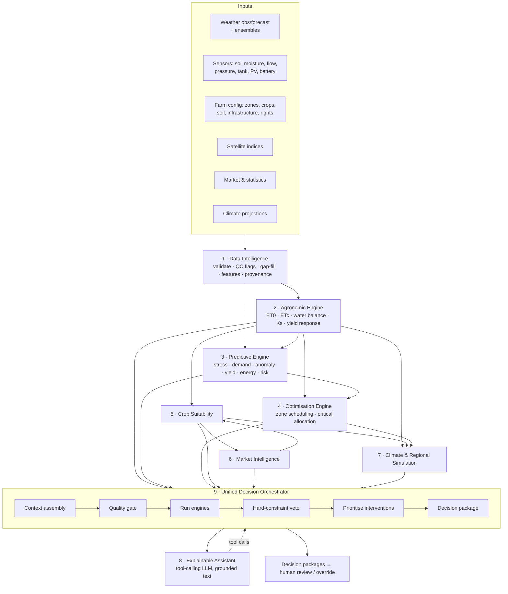
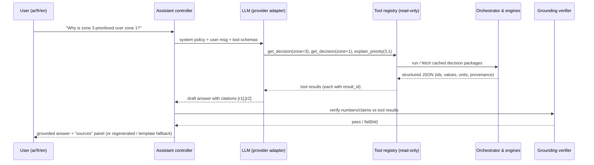

# QATRA AI Intelligence Engine: Technical Blueprint (v0.1)

> Status: **proposal awaiting approval**. Nothing in this document is implemented yet.
> Date: 2026-11-21. Companion to [BLUEPRINT.md](BLUEPRINT.md), which covers the platform.

**Guiding question:** *When water, energy and information are scarce, where should we intervene first to prevent the most irreversible damage?*

**Design stance:**
1. **Physics first, ML second.** Wherever accepted agronomic or hydraulic models exist (FAO‑56, FAO‑33, pump hydraulics, PV models), they are the baseline. They need no training data, they can be explained, and they work on day one. ML models are added only where they beat that baseline on real, held-out data.
2. **The model's validation status is part of every output.** Each output says how far its model has been checked: *literature-parameterised*, *simulation-tested*, *pilot-validated* or *field-validated*. Today everything would be the first or second.
3. **The LLM talks; it does not compute.** It calls tools that run the real models and explains their structured results. Every number it states must trace back to a tool output.
4. **"I don't know" is a valid output.** Missing, stale or contradictory inputs produce `insufficient_evidence` with a list of what is missing.

---

## 0. Relationship to the existing repository

- The partial platform backend (`backend/`: auth, farms, models) is **paused, not deleted**.
- The AI engine is a **separate Python package**, `ai_engine/` (import name `qatra_ai`), with **no dependency on the web backend, its database, or its auth**.
  - Inputs and outputs are typed contracts (§8). The platform backend will call it later, as a library or through its thin FastAPI service.
  - This keeps the engine independently testable and reusable, for example by a GDA (water user association) tool, a research notebook or an edge device.

```
ai_engine/
├─ qatra_ai/
│  ├─ contracts/        # Pydantic I/O schemas shared by all modules (§8)
│  ├─ data/             # validation, QC flags, gap handling, unit normalisation, feature engineering
│  ├─ agronomy/         # ET0, Kc, root-zone water balance, Ks, irrigation requirement, yield response
│  ├─ energy/           # PV production, pump hydraulics, battery model
│  ├─ predictive/       # stress, demand, anomaly, yield, energy, weather-risk models
│  ├─ optimization/     # multi-zone scheduling, critical allocation, crop portfolio
│  ├─ suitability/      # crop suitability (limiting-factor method + Pareto trade-offs)
│  ├─ market/           # price baselines, supply scenarios, reflexivity loop
│  ├─ climate/          # delta-change scenarios, groundwater bucket, regional simulation
│  ├─ remote_sensing/   # Sentinel-2/1 indices, parcel zonal stats, change detection
│  ├─ assistant/        # LLM adapter, tool registry, grounding verifier, RAG
│  ├─ orchestrator/     # unified decision pipeline, intervention prioritisation, safety veto
│  └─ evaluation/       # backtests, synthetic-leak benchmarks, metrics, model cards
├─ reference_data/      # crop/soil parameter tables with citations (YAML), versioned
├─ service/             # thin FastAPI wrapper (no auth logic; runs behind the platform)
├─ experiments/         # MLflow-tracked training/evaluation scripts
└─ tests/               # unit (formula checks vs FAO-56 worked examples), property, integration
```

The core needs only numpy, pandas, scipy, pydantic, ortools and scikit-learn. Heavy geospatial packages (GeoPandas, Rasterio, Xarray) are optional extras, used only by `remote_sensing` and `climate`.

---

## 1. AI architecture



**Execution modes:**

| Mode | Trigger | Example |
|---|---|---|
| Scheduled batch | Daily / hourly | Update water balance for all zones, run anomaly detection, refresh 72 h schedule |
| On-demand | API / assistant tool call | "Compare equal-share vs. minimum-loss allocation for scheme X" |
| Event-driven | New telemetry or anomaly | Pressure drop leads to an anomaly hypothesis and an intervention ranking |
| Scenario | User-defined | Climate 2050, SSP2‑4.5 with rainfall cut by 20% |

---

## 2. Module-by-module design

### 2.1 Module A: Agricultural Data Intelligence

**Purpose:** turn heterogeneous raw inputs into trustworthy, unit-consistent, provenance-tagged features.

**Pipeline:** `ingest → schema check → unit normalisation → QC flags → gap handling → feature engineering → provenance summary`

| QC test | Applies to | Rule (configurable per sensor model) |
|---|---|---|
| Range | All | Physical bounds, e.g. θ ∈ [0, 0.6] m³/m³, RH ∈ [0, 100] |
| Rate of change (spike) | Sensors | \|Δx/Δt\| > max rate, e.g. soil moisture +0.15 m³/m³ in 10 min with no irrigation or rain |
| Flat-line / stuck | Sensors, meters | Variance ≈ 0 over N hours while the context says it should vary |
| Cross-consistency | Multi-source | Soil-moisture rise with no rain and no irrigation; flow > 0 while the pump is off |
| Water-balance residual | Soil moisture | Persistent divergence between the sensor and the FAO‑56 model points to sensor drift *or* a model error. Both are flagged; neither is assumed. |
| Timestamp | All | Future timestamps, duplicates, clock drift (device time vs. receive time) |
| Calibration | Sensors | Uncalibrated or expired calibration: usable for trend only |

**Gap handling.** Short gaps (≤ 2 h) are interpolated and flagged `gap_filled`. Longer gaps are never silently filled. For weather, a fallback source is used (for example ERA5-Land in place of a missing station) and its provenance is recorded.

**Feature store.** Kept deliberately simple for now: features are computed on demand by pure functions over a time-indexed DataFrame, with a versioned feature definition registry. Every feature carries:
- the data classes of its inputs;
- its validity window;
- its quality grade (A: measured and calibrated; B: measured but uncalibrated or official; C: remote or inferred; D: simulated or projected).

**Key features:** cumulative ET0/ETc, depletion and days-to-RAW, growing degree days (GDD), vapour-pressure deficit (VPD), heat-stress hours, rain-forecast probability buckets, night-minimum flow, flow/pressure ratio, NDVI/NDMI slope and anomaly against the parcel's own history, stage-relative day.

**Confidence indicator.** A deterministic function of freshness, coverage, quality grade, calibration status and the model's validation status. Its output is `high | medium | low | insufficient_evidence`, together with the reasons.

### 2.2 Module B: Predictive Intelligence

Each predictor follows a **baseline → challenger** path. A challenger ML model replaces the baseline only if it beats it on real held-out data (§9).

| Task | Baseline (day 1, no training) | Challenger (needs data) | Output |
|---|---|---|---|
| Crop water stress (now and 1–7 days ahead) | FAO‑56 Ks from the water balance, driven by the forecast | LightGBM classifier with monotonic constraints (stress ↑ with depletion, VPD, ET0); features from §2.1 plus NDMI | P(Ks < 0.8) per day, days-to-stress, drivers |
| Irrigation water demand | FAO‑56 net/gross requirement × area, from forecast ET0 (ensemble for intervals) | Hybrid model: physics plus a gradient-boosted residual model trained on metered consumption | Quantiles P10/P50/P90 in m³ per zone/farm/day |
| Leak and abnormal consumption | Mass balance, plus robust z-scores (median/MAD) on residuals, CUSUM/EWMA, night-minimum flow and pressure-drop rules | Isolation Forest or STL-residual detector per meter, once ≥ 8 weeks of history exist | Anomaly events with hypotheses, evidence, severity and confidence. **Never "theft".** |
| Yield / production | FAO‑33 stage-wise yield response from the simulated ETa/ETm | AquaCrop-OSPy (FAO's open crop model) calibrated per crop; regional statistical model (regularised regression or mixed effects) on governorate statistics | Relative yield (Ya/Ym) with interval; absolute only if Ym is locally known |
| Energy consumption | Pump hydraulics × scheduled volume | Gradient-boosted residuals on metered kWh | kWh per slot, P10/P50/P90 |
| PV production | Irradiance forecast → plane-of-array model → temperature-derated PV model | Bias correction using measured PV power | kW per slot, quantiles |
| Weather-related risk | Exceedance probabilities from ensemble forecasts against crop-stage thresholds (heat > 40 °C at flowering, frost < 0 °C at flowering for citrus/almond, hot dry wind, heavy rain > 30 mm/day) | Calibration with isotonic regression against observed events | P(event) per day, with stage context |

**Why these algorithms:**
- **Gradient boosting (LightGBM/XGBoost)** is the best default for small-to-medium tabular data. It handles missing values natively, supports monotonic constraints (which keeps the agronomic sense), and SHAP explanations are cheap to compute.
- **Random Forest** is kept as a robust comparison model.
- **Robust statistics (MAD, CUSUM)** for anomalies: labelled leaks are extremely rare, so unsupervised and statistical methods must come first.
- **Deep learning (LSTM/Transformers)** is not justified until there are many sensor-years of data. It can be revisited later for multi-site sequence models.
- **Statsmodels** (SARIMAX/ETS) for price and consumption series where seasonality dominates.

### 2.3 Module C: Agronomic Intelligence

Implements FAO Irrigation & Drainage Paper 56 (Allen et al., 1998), FAO‑33 (Doorenbos & Kassam, 1979), FAO‑29 (salinity) and Saxton & Rawls (2006) pedotransfer functions. Formulas are given in §5.

**Components:**
- `et0`: Penman–Monteith (full). Hargreaves–Samani is the fallback when radiation, humidity or wind is missing, and the result is flagged as lower confidence.
- `kc`:
  - single-Kc curve per stage with FAO‑56 climatic adjustment of Kc_mid/Kc_end;
  - dual Kc (Kcb + Ke) for drip and partial wetting (phase 2 of the module);
  - ground-cover reduction for young orchards.
- `soil`: θFC and θWP from texture and organic matter (Saxton–Rawls) when no lab values exist; TAW and RAW from these with root depth.
- `water_balance`: daily root-zone depletion with runoff, deep percolation and capillary rise (assumed 0 unless a shallow water table is declared); linear root growth; Ks.
  - **Sensor assimilation:** when calibrated soil-moisture sensors exist, depletion is reset or corrected towards the sensor estimate, weighted by sensor uncertainty (a scalar Kalman update). The innovation is logged as a model-error metric.
- `irrigation_requirement`: net depth → gross depth (application efficiency) → volume → runtime (from the design flow); leaching requirement where irrigation-water salinity is known.
- `yield_response`: stage-wise Ky, used for both loss estimation and optimisation weights.
- `perennial_survival`: for trees (olive, citrus, date palm, almond), a cumulative-deficit indicator against a survival-risk threshold. **This is the main signal for "irreversible damage"**: losing a 30-year olive tree is not the same as losing one season of tomatoes.

**Crop profiles (`reference_data/crops/*.yaml`).** Each profile holds Kc per stage, stage lengths, root depth range, p, Ky per stage, salinity threshold and slope, temperature thresholds, and a perennial flag. **Every parameter carries a citation and a `local_validation: none|partial|validated` field.** Initial values come from FAO‑56 Tables 11, 12 and 22, FAO‑33 and the FAO‑29 salinity tables, and must be reviewed by a Tunisian agronomist.

### 2.4 Module D: Intelligent Irrigation Optimisation (farm level)

This module decides **which zone gets how much water, and when**, over a rolling 72‑hour horizon. Constraints: hydraulics, tank, allocation, energy (PV, battery, grid windows) and operating rules. The objective is to minimise **stage-weighted, irreversibility-weighted water stress**; it does not split water equally. Formulation in §6.1.

**Solver.** Mixed-integer linear programming (MILP) via OR-Tools (MathOpt with the HiGHS or SCIP backend). Typical size is 10 zones × 72 slots, about 1,000 binary variables, which solves in seconds.

**Robustness:**
- Energy uses the P10 PV forecast (a conservative, chance-constrained approximation).
- Rain uses expected effective rain discounted by forecast probability.
- The plan is re-optimised every few hours (rolling horizon / model-predictive control).

**Outputs:** the schedule; why each zone is in or out (binding constraints, shadow prices); the projected stress trajectory with and without the plan; and the water and energy used.

### 2.5 Module E: Critical Water Allocation (multi-farm)

This module distributes a limited volume between farms or zones in a scheme or region. It minimises expected **irreversible** losses subject to:
- human water needs as a hard reservation;
- entitlements;
- infrastructure capacity;
- groundwater limits;
- explicit fairness constraints.

It is a convex piecewise-linear program, solved as a linear program, so results are reproducible and dual values are interpretable. Formulation in §6.2.

**Strategies compared side by side:**

| Strategy | Description |
|---|---|
| S1 Proportional | Share proportional to entitlement (status-quo reference) |
| S2 Equal per hectare | Same depth for everyone |
| S3 Crop priority | Perennials and sensitive stages first, in a fixed order |
| S4 Minimum loss | Pure loss minimisation (can be very unequal) |
| S5 Minimum loss with fairness floor | S4 plus every farm ≥ φ·entitlement-share and a vulnerability weighting |
| S6 Max-min fairness | Maximise the worst-off farm's satisfaction ratio, then minimise loss |

**For each strategy the output shows:**
- allocation per farm, % of demand and % of entitlement;
- estimated loss (physical: yield %, trees at risk; monetary only if prices are supplied);
- winners and losers relative to S1;
- fairness metrics (Gini, Jain index, minimum satisfaction);
- the marginal value of one extra m³ (dual price);
- every assumption used.

**The engine never states that a strategy is "fair" or "authorised".** It shows the consequences; people decide.

### 2.6 Module F: Crop Suitability Intelligence

Two stages, deliberately **not a single score**.

1. **Limiting-factor suitability (FAO Land Evaluation Framework).**
   - Each factor is classified S1, S2, S3 or N against crop requirements. Factors: climate (GDD, chill hours for fruit trees, heat and frost risk), soil (texture, depth, salinity ECe, pH, drainage), water (seasonal requirement vs. available), energy (pumping requirement vs. reliable supply) and slope.
   - The overall class is the most limiting factor.
   - Each factor shows its value, the threshold, its data class and whether it is missing.
2. **Trade-off analysis among the crops that are not excluded.**
   - Indicators: expected gross margin (interval), seasonal water use (m³), water productivity (TND/m³ and kg/m³), energy use (kWh), climate exposure (share of 2040–2060 scenarios where the crop drops a class), market risk (§2.7) and irreversibility (perennial lock-in).
   - Results are presented as a **Pareto set** (non-dominated crops), with the dominating factors explained.
   - An optional ranking appears only after the user chooses priorities explicitly (lexicographic or weighted). The weights are shown, never hidden.
3. **Portfolio option.** A farm-level crop-area mix (§6.3) for diversification, which is often better than choosing a single "best crop".

Missing inputs (for example no soil analysis) lower confidence and are listed. When a factor is critical, the result is reported as *undetermined*, not passed by default.

### 2.7 Module G: Market Intelligence

**Data reality.** National data from FAOSTAT is annual. Tunisian wholesale and market prices are published by national bodies (for example ONAGRI and the Ministry of Agriculture), but their availability, granularity and terms **must be verified**. Short-term price forecasting is only attempted if a usable series exists.

**Components:**
- **Descriptive:**
  - seasonality profiles (STL);
  - volatility;
  - historical price distribution for each month of sale.
- **Forecast ranges** (only with ≥ ~5 years of data at monthly or finer resolution):
  - baselines first: seasonal naive and ETS/SARIMAX;
  - LightGBM with exogenous drivers only if it beats the baselines in backtests;
  - output is always quantiles (P10/P50/P90).
- **Supply scenarios.** Production = area × yield distribution. Area comes from declared or estimated planting intentions; yield comes from §2.2 under weather scenarios. Imports and exports are scenario parameters, not predictions.
- **Reflexivity loop (key requirement).** If many farmers adopt the same recommendation, regional supply rises and prices fall:
  - inverse demand with elasticity ranges (formulation in §6.4);
  - a fixed-point iteration: recommend → aggregate areas → price band → re-evaluate margins, repeated until stable;
  - outputs:
    - an explicit *"if X% of farms in the region follow this"* sensitivity;
    - signals to diversify;
    - an optional regional cap on how much area the engine itself pushes toward one crop.

Prices are never guaranteed. Every market output carries its backtest error and its scenario assumptions.

### 2.8 Module H: Climate and Regional Simulation

**Scenarios, not predictions.** Each run is labelled `historical` (observed baseline), `projected` (CMIP6-derived) or `hypothetical` (user stress test).

- **Climate forcing: delta-change method.**
  - Monthly changes in temperature and precipitation from a CMIP6 ensemble (e.g. NASA NEX-GDDP-CMIP6, 0.25°) are applied to a 20–30-year local baseline series (station or ERA5-Land).
  - Scenarios: SSP2‑4.5 and SSP5‑8.5, horizons 2041–2060 and 2081–2100.
  - Results are reported as an ensemble distribution, not the ensemble mean alone.
- **Impact chain per scenario:**
  - ET0 → crop water requirement → water balance → yield response;
  - suitability class shifts;
  - pumping energy (requirement × head, with head changing via groundwater).
- **Groundwater: lumped aquifer bucket per aquifer unit.** Recharge is precipitation-dependent and needs aquifer parameters (formulation in §6.5). Parameters (area, specific yield, recharge coefficient, baseline extraction) must come from DGRE (Tunisia's water resources directorate) publications or literature. **Without them, this sub-module runs only in hypothetical mode.**
- **Regional simulation (agent-based-lite).**
  - Farms (synthetic or real, labelled) choose crops via §2.6/§6.3 rules.
  - Their demand is aggregated, water is allocated via §6.2, then yields, production, prices (§2.7) and groundwater are updated.
  - The loop runs over multiple years and scenario ensembles.
  - Outputs: distributions of regional production, unmet demand, groundwater level, energy use and resilience indicators.

### 2.9 Module I: Satellite and Remote Sensing

**Sources:**
- Sentinel‑2 L2A (10–20 m, ~5 days) via the Copernicus Data Space Ecosystem;
- Sentinel‑1 SAR (all-weather);
- coarser scales: WaPOR v3 ET, ESA WorldCover, Landsat thermal.

**Processing:**
- cloud and shadow masking (Sentinel-2 scene classification);
- per-parcel zonal statistics (mean, P10, P90), counting only fully-inside pixels;
- a minimum number of valid pixels, without which the observation is rejected;
- indices: NDVI, NDRE, NDMI (canopy water content proxy);
- smoothing (Whittaker) for trends only, never for decision-critical values.

**Uses:**
- crop-condition trend against the parcel's own history and similar parcels;
- detection of vegetation change (planting, harvest, abandonment, tree loss);
- a weak, supporting feature for the stress model;
- regional land-use mapping for simulations.

**Explicit limits:**
- Optical indices do **not** measure root-zone soil moisture.
- SAR backscatter senses only the top few centimetres and is confounded by vegetation and roughness.
- Satellites cannot confirm an individual leak.
- Parcels below about 0.3 ha are often unreliable.

### 2.10 Module J: Explainable AI Assistant

Architecture in §7.

### 2.11 Unified Decision Orchestrator

**Pipeline for each decision request:**
1. **Assemble context.** Farm configuration, latest states and forecasts. Everything is gathered as one immutable snapshot (its hash is stored).
2. **Quality gate.** Required inputs per decision type. If anything is missing, return `insufficient_evidence` with the list.
3. **Run engines.** Agronomy, then predictors, then optimisers, in a dependency-ordered graph (a plain DAG in code, no workflow engine).
4. **Hard-constraint veto.** A rule layer that cannot be overridden by optimisation or the LLM:
   - never schedule beyond allocation or tank minimum;
   - never exceed pump or pressure limits;
   - human drinking-water reservation first;
   - never auto-execute physical actions without a human approval policy.
5. **Prioritise interventions.** A lexicographic ranking, so there is **no opaque single score**:
   1. safety and human water needs;
   2. **irreversible-loss risk**: perennial survival risk, or a sensitive stage (high Ky) with days-to-critical-stress ≤ horizon;
   3. time to damage (fewest days first);
   4. avoided loss per m³ and per kWh (efficiency);
   5. cost and effort.

   Each step records why one item ranks above another.
6. **Decision package.** The §8 envelope with action, reasons, supporting measurements, constraints, confidence, expected impact, alternatives, data limitations and the human-review requirement.
7. **Feedback.** Human approve, modify or reject decisions, and later outcomes, are logged for evaluation (the learning loop). Overrides are data, not errors.

---

## 3. Algorithm choices: summary and justification

| Problem | Chosen | Rejected or deferred, and why |
|---|---|---|
| ET0 | FAO‑56 Penman–Monteith; Hargreaves fallback | ML ET0: no benefit when the physics model is the international standard |
| Soil-water state | FAO‑56 bucket model with scalar Kalman assimilation | Richards-equation models: too many unknown soil parameters |
| Stress prediction | Physics Ks → LightGBM (monotonic) | Deep nets: no data volume |
| Demand forecasting | Physics + gradient-boosted residuals, quantile outputs | Pure ARIMA: ignores weather causality |
| Anomaly | Mass balance + MAD/CUSUM → Isolation Forest | Supervised classifiers: no labelled leaks |
| Yield | FAO‑33 → AquaCrop-OSPy → statistical regional model | Satellite-only yield models: unvalidated locally |
| Zone scheduling | MILP (OR-Tools MathOpt + HiGHS/SCIP) | Heuristics only: no optimality or dual information; RL: unsafe and opaque |
| Allocation | Convex piecewise-linear LP; lexicographic fairness | Black-box metaheuristics: not explainable, not reproducible |
| Suitability | FAO limiting-factor method + Pareto | Single weighted score: hides trade-offs (explicitly disallowed) |
| Market | Seasonal baselines → SARIMAX/ETS → gradient boosting; elasticity-based reflexivity | Point price forecasts: misleading |
| Climate | Delta-change on CMIP6 ensemble | Single-model projection: overconfident |
| Explanations | SHAP for ML, constraint duals for optimisation, rule traces for rules | LLM-generated reasoning without a source |

---

## 4. Required datasets and possible sources

Availability, licence and resolution must be confirmed before use. Items marked ⚠ are uncertain or need a partnership.

| Need | Dataset | Resolution / period | Access | Used by |
|---|---|---|---|---|
| Weather obs and forecast | Open-Meteo (forecast, ensemble, historical, ERA5) | ~1–25 km, hourly | Free for non-commercial use; paid or self-hosted for commercial | A, B, C, D |
| Reanalysis baseline | ERA5-Land (Copernicus CDS) | 9 km, hourly, 1950– | Free | C, H |
| Precipitation | CHIRPS v2 | 0.05°, daily, 1981– | Free | C, H |
| Solar | NASA POWER; Open-Meteo radiation | 0.5°/km-scale | Free | B (energy) |
| Station data | INM Tunisia ⚠ | Point | Partnership | A, C (bias correction) |
| Soil | ISRIC SoilGrids 250 m; HWSD v2; farm lab analyses ⚠ | 250 m / point | Free / farmer | C, F |
| Elevation | Copernicus DEM GLO‑30 | 30 m | Free | D (head), F (slope) |
| Crop parameters | FAO‑56 tables, FAO‑33 Ky, FAO‑29 salinity, AquaCrop crop files | Reference | Free (cite) | C, F |
| Crop suitability benchmark | FAO GAEZ v4 | ~9 km | Free | F (cross-check) |
| Satellite | Sentinel‑2 L2A, Sentinel‑1 GRD (CDSE) | 10–20 m, ~5–6 days | Free (account, quotas) | I, B |
| Water productivity / ET | FAO WaPOR v3 | 300 m / 100 m, dekadal | Free | I, H, benchmarking |
| Land cover | ESA WorldCover | 10 m | Free | H, I |
| Groundwater (regional trend) | GRACE/GRACE‑FO | ~300 km, monthly | Free | H (context only) |
| Aquifer parameters, extraction | DGRE yearbooks/reports ⚠ | Aquifer unit | Publications / partnership | H |
| Production, area, yield | FAOSTAT; national statistics (ONAGRI, INS, Ministry of Agriculture yearbooks) ⚠ | National / governorate, annual | Free / to verify | B (yield), G, H |
| Prices | National wholesale price series ⚠; FAOSTAT producer prices; FAO FPMA tool | Weekly–annual | To verify | G |
| Trade | FAOSTAT trade; UN Comtrade | Annual/monthly | Free | G |
| Climate projections | NASA NEX-GDDP-CMIP6; CMIP6 via CDS | 0.25°, daily | Free | H |
| Field truth: soil moisture, flow, pressure, consumption, yields | **Pilot farms** ⚠ | Point, sub-hourly | **Required for any ML challenger** | B (training & evaluation) |
| Allocation rules, entitlements | GDA / CRDA (water user associations / regional agriculture offices) ⚠ | Scheme | Partnership | E |
| Costs | Extension services, farmer records ⚠ | Crop | Partnership / survey | F, G |

**Simulated data policy:**
- Synthetic farms, sensor streams and injected leaks are generated by `evaluation/synthetic.py` with a fixed seed.
- They are labelled `data_class=simulated` in every record.
- Results on them are reported only as *simulation-tested*, never as real-world performance.

---

## 5. Agronomic and physical formulas

FAO‑56 equation numbers are given in brackets.

### 5.1 Reference evapotranspiration: FAO‑56 Penman–Monteith [Eq. 6]

$$ET_0=\frac{0.408\,\Delta\,(R_n-G)+\gamma\,\frac{900}{T+273}\,u_2\,(e_s-e_a)}{\Delta+\gamma\,(1+0.34\,u_2)}$$

- $\Delta=\dfrac{4098\,[0.6108\,e^{17.27T/(T+237.3)}]}{(T+237.3)^2}$ [13]
- $\gamma=0.665\times10^{-3}P$ [8], with $P=101.3\left(\frac{293-0.0065z}{293}\right)^{5.26}$ [7]
- $e_s=\frac{e^\circ(T_{max})+e^\circ(T_{min})}{2}$ [12], with $e^\circ(T)=0.6108\,e^{17.27T/(T+237.3)}$ [11]
- $e_a=e^\circ(T_{dew})$ [14] (or from RH [17])
- $R_n=(1-0.23)R_s-R_{nl}$ [38, 39]
- $R_{nl}=\sigma\,\frac{T_{max,K}^4+T_{min,K}^4}{2}(0.34-0.14\sqrt{e_a})\left(1.35\frac{R_s}{R_{so}}-0.35\right)$ [39]
- $R_{so}=(0.75+2\times10^{-5}z)R_a$ [37]
- $G\approx0$ for daily steps
- Wind at 2 m: $u_2=u_z\frac{4.87}{\ln(67.8z_m-5.42)}$ [47]

**Fallback: Hargreaves–Samani [52]:** $ET_0=0.0023\,(T_{mean}+17.8)\,(T_{max}-T_{min})^{0.5}\,0.408R_a$

### 5.2 Crop evapotranspiration

- $ET_c=K_c\,ET_0$ [56]. Kc is interpolated linearly between stage values.
- Climate adjustment [62]: $K_{c,mid}=K_{c,mid(tab)}+[0.04(u_2-2)-0.004(RH_{min}-45)]\left(\frac{h}{3}\right)^{0.3}$
- Dual coefficient [69]: $K_c=K_{cb}+K_e$
- Under stress [80]: $ET_{c,adj}=K_s\,K_c\,ET_0$

### 5.3 Root-zone water balance

- $TAW=1000(\theta_{FC}-\theta_{WP})Z_r$ [82]
- $RAW=p\cdot TAW$ [83], with $p=p_{tab}+0.04(5-ET_c)$, clipped to [0.1, 0.8]
- Daily depletion [85]: $D_{r,i}=D_{r,i-1}-(P-RO)_i-I_i-CR_i+ET_{c,i}+DP_i$, with $0\le D_{r,i}\le TAW$
- Stress coefficient [84]: $K_s=\dfrac{TAW-D_r}{(1-p)\,TAW}$ if $D_r>RAW$, else $K_s=1$
- Root growth: $Z_r(t)=Z_{r,min}+(Z_{r,max}-Z_{r,min})\frac{t-t_{0}}{t_{max}-t_0}$, limited by declared soil depth.
- **Effective rainfall (documented assumption):** $RO$ from the SCS curve number when the CN is known. Otherwise $P_{eff}=0$ for $P<5$ mm/day (lost to interception and evaporation) and $P_{eff}=P$ up to the available storage, with the excess going to deep percolation. This is configurable and flagged.
- **Sensor assimilation:**
  - $D_r^{+}=D_r^{-}+K\,(D_r^{obs}-D_r^{-})$, with $K=\frac{\sigma_m^2}{\sigma_m^2+\sigma_o^2}$
  - $D_r^{obs}=1000(\theta_{FC}-\theta_{obs})Z_r$, from a calibrated sensor in the root zone.

### 5.4 Irrigation requirement

- Net depth to refill: $I_n=D_r$ (or $D_r - $ a target allowed depletion, for deficit irrigation)
- Gross depth: $I_g=I_n/E_a$ (E_a ≈ 0.85–0.95 for drip, 0.7–0.8 for sprinkler, 0.5–0.6 for surface)
- Volume: $V\,[\text{m}^3]=10\,I_g\,[\text{mm}]\times A\,[\text{ha}]$
- Runtime: $t=V/Q_{design}$
- Leaching requirement (FAO‑29): $LR=\frac{EC_w}{5\,EC_e-EC_w}$, so $I_g=\frac{I_n}{E_a(1-LR)}$

### 5.5 Yield response (FAO‑33)

- Whole season: $1-\frac{Y_a}{Y_m}=K_y\left(1-\frac{ET_a}{ET_m}\right)$
- Stage-wise (multiplicative): $\frac{Y_a}{Y_m}=\prod_s\left[1-K_{y,s}\left(1-\frac{ET_{a,s}}{ET_{m,s}}\right)\right]$
- **Salinity:** $\frac{Y}{Y_m}=1-\frac{b}{100}(EC_e-EC_{e,threshold})$, applied multiplicatively.

### 5.6 Soil hydraulic properties (Saxton & Rawls, 2006)

θ at 1500 kPa (WP) and 33 kPa (FC) are computed from the sand, clay and organic-matter fractions with the published regressions, including density and gravel corrections. They are used only when lab values are absent, and flagged `inferred`.

### 5.7 Energy

- **Pump hydraulic energy:** $E\,[\text{kWh}]=\frac{\rho g\,V\,H}{3.6\times10^6\,\eta_{pump}\eta_{motor}}$, which is approximately $\frac{2.725\times10^{-3}\,V\,[\text{m}^3]\,H\,[\text{m}]}{\eta}$
  - Total dynamic head: $H=H_{static}+H_{friction}+H_{pressure}$
- **PV:** $P_{pv}=P_{rated}\frac{G_{poa}}{1000}\left[1+\gamma_T(T_{cell}-25)\right]\eta_{sys}$, with $T_{cell}=T_{air}+\frac{NOCT-20}{800}G_{poa}$
- **Battery:** $SOC_{t+1}=SOC_t+\eta_c b^{ch}_t-b^{dis}_t/\eta_d$
- **Gravity feasibility (screening only):** available head $=\Delta z - h_f$ (Hazen–Williams friction), checked against the emitter pressure requirement. This must be confirmed with field hydraulic data.

---

## 6. Mathematical formulation of the optimisation problems

### 6.1 Multi-zone irrigation scheduling (farm, rolling 72 h)

**Sets:** zones $z\in Z$; time slots $t\in T$ (1 h).

**Parameters:**

| Symbol | Meaning |
|---|---|
| $Q_z$ | Zone design flow (m³/h) |
| $A_z$ | Zone area (ha) |
| $E_{a,z}$ | Application efficiency |
| $D_{z,0}$ | Initial depletion (mm) |
| $ET_{z,t}$, $P_{z,t}$ | Forecast crop ET and effective rain (mm/slot) |
| $RAW_z$, $TAW_z$ | Readily / total available water (mm) |
| $Q^{max}$, $N^{max}$ | Pump capacity; maximum simultaneous zones |
| $L_0$, $L^{min}$, $L^{max}$, $In_t$ | Tank level bounds and inflow |
| $W$ | Remaining allocation |
| $e_z$ | Pump energy per slot for zone z (kWh), from §5.7 |
| $PV_t^{P10}$ | Conservative PV forecast (kWh) |
| $G_t\in\{0,1\}$, $\bar g$ | Grid availability, grid capacity |
| Battery parameters | Capacity and efficiencies |
| $\Omega_t\in\{0,1\}$ | Allowed operating window |
| $w_{z,t}$ | Stress weight (below) |

**Variables:**
- $x_{z,t}\in\{0,1\}$: zone z irrigated during slot t
- $D_{z,t}\ge0$: depletion
- $s_{z,t}\ge0$: depletion beyond RAW (stress)
- $L_t$: tank level
- $b^{ch}_t, b^{dis}_t, g_t\ge0$: battery charge/discharge, grid draw
- $SOC_t$: battery state of charge

**Constraints:**

| Group | Constraint |
|---|---|
| Soil dynamics | $D_{z,t+1}\ge D_{z,t}+ET_{z,t}-P_{z,t}-\frac{E_{a,z}Q_z}{10A_z}x_{z,t}$ |
| | $D_{z,t}\ge0$ (excess drains, so no credit above field capacity) |
| Stress | $s_{z,t}\ge D_{z,t}-RAW_z$ |
| Hydraulics | $\sum_z Q_z x_{z,t}\le Q^{max}$ |
| | $\sum_z x_{z,t}\le N^{max}$ |
| | $x_{z,t}\le\Omega_t$ |
| Tank | $L_{t+1}=L_t+In_t-\sum_z Q_z x_{z,t}$ |
| | $L^{min}\le L_t\le L^{max}$ |
| Allocation | $\sum_{z,t}Q_z x_{z,t}\le W$ |
| Energy | $\sum_z e_z x_{z,t}+b^{ch}_t\le PV^{P10}_t+b^{dis}_t+g_t$ |
| | $g_t\le G_t\,\bar g$ |
| | SOC dynamics and bounds (§5.7) |
| Operations (optional) | Minimum/maximum consecutive run, start-up limits, precedence |

**Objective:**

$$\min\ \sum_{z,t} w_{z,t}\,s_{z,t}\;+\;\lambda_E\sum_t c_t\,g_t\;+\;\lambda_W\sum_{z,t}Q_zx_{z,t}\;+\;\mu\sum_z w_{z,|T|}\,s_{z,|T|}$$

The stress weight is

$$w_{z,t}=K_{y}(\text{stage}_{z,t})\times(1+\kappa\cdot\text{perennial}_z\cdot\text{survival\_risk}_{z,t})\times A_z$$

so stress counts most where it is most damaging and least reversible.
- $\lambda$ parameters are small tie-breakers (save water and grid energy).
- The terminal term avoids pushing stress beyond the horizon.
- Weights and $\kappa$ are explicit, shown, and tested for sensitivity.

### 6.2 Critical water allocation between farms

**Sets:** farms $f\in F$; supply branches $b\in B$; aquifers $k\in K$.

**Parameters:**

| Symbol | Meaning |
|---|---|
| $W$ | Available surface water |
| $H$ | Human / drinking water reservation |
| $R^{env}$ | Environmental reserve |
| $d_f$ | Demand (from §2.2, P50) |
| $ent_f$ | Entitlement |
| $C_b$ | Branch capacity |
| $SY_k$ | Sustainable groundwater yield |
| $\alpha_k$ | Allowed fraction of $SY_k$ |
| $v_f\ge1$ | Vulnerability weight (policy input) |
| $\phi$ | Fairness floor (policy input) |
| $\ell_f(\cdot)$ | Loss function |

**Variables:**
- $a_f\ge0$: surface allocation
- $q_f\ge0$: groundwater pumping (if the farm has a well)
- $\delta_f\ge0$: unmet demand

**Loss function.** Expected irreversible loss of farm f as a function of its deficit ratio $r_f=\delta_f/d_f$:

$$\ell_f(\delta_f)=V_f\,K_{y,f}\,\frac{\delta_f}{d_f}\;+\;\Pi_f\cdot\max\!\left(0,\frac{\delta_f}{d_f}-\tau_f\right)$$

- First term: seasonal yield loss (FAO‑33), in physical units or value $V_f$.
- Second term: an **irreversibility penalty** for perennial or critical-stage crops beyond the survival threshold $\tau_f$, with $\Pi_f\gg V_fK_{y,f}$.
- It is convex piecewise linear. Further segments approximate the increasing marginal damage, giving an LP with epigraph variables $\eta_f\ge$ each segment.

**Constraints:**

| Group | Constraint |
|---|---|
| Supply balance (hard; human needs first) | $\sum_f a_f\le W-H-R^{env}$ |
| Demand | $a_f+q_f+\delta_f=d_f$ |
| | $a_f+q_f\le d_f$ |
| Infrastructure | $\sum_{f\in b}a_f\le C_b$ for each branch $b$ |
| Groundwater | $\sum_{f\in k}q_f\le\alpha_k\,SY_k$ |
| | $q_f\le \text{well capacity}_f$ |
| Entitlements (policy) | $a_f\ge\rho\cdot ent_f\cdot\frac{W-H-R^{env}}{\sum_g ent_g}$, with $\rho\in[0,1]$ the strength of entitlement protection |
| Fairness floor (S5) | $\frac{a_f+q_f}{d_f}\ge\phi$ for all f, with infeasibility reported if $\phi$ is too high |

**Objectives by strategy:**
- **S4/S5:** $\min \sum_f v_f\,\ell_f(\delta_f)$
- **S6 (lexicographic):**
  1. $\max\ \theta$ s.t. $\frac{a_f+q_f}{d_f}\ge\theta$ for all f
  2. Fix $\theta\ge\theta^*-\epsilon$, then $\min\sum_f v_f\ell_f$

**Reported metrics:**
- per farm: allocation, satisfaction ratio and estimated loss;
- winners and losers relative to S1;
- fairness:
  - Gini of satisfaction ratios;
  - Jain index $J=\frac{(\sum r_f)^2}{|F|\sum r_f^2}$;
  - minimum satisfaction;
- the dual of the supply constraint (marginal loss avoided per extra m³);
- binding constraints;
- infeasibility explanations, for example "entitlements exceed available water by 18%".

### 6.3 Crop portfolio (farm or region, one season)

**Variables:** $x_c\ge0$, area of crop c.

**Constraints:**
- Land: $\sum_c x_c\le A$
- Water: $\sum_c x_c\,WR_c\le W$
- Energy: $\sum_c x_c\,EN_c\le E$
- Agronomy: rotation, minimum and maximum shares
- Exclusions: $x_c=0$ for crops in suitability class N

**Objective (risk-aware):**

$$\max\ \mathbb{E}_\omega[\pi(x,\omega)]-\beta\cdot\mathrm{CVaR}_{\alpha}[-\pi(x,\omega)]$$

- Scenarios ω combine price and yield samples (from §2.2 and §2.7).
- This is solved as an LP with Rockafellar–Uryasev auxiliary variables.
- Water productivity and climate exposure are shown alongside, or added as an ε-constraint to trace the Pareto front.

### 6.4 Market reflexivity

- Regional supply: $Q_c=\sum_f x_{f,c}Y_{f,c}+Q_c^{other}$
- Inverse demand around the reference: $p_c=p_c^{0}\left(\frac{Q_c+M_c}{Q_c^{0}+M_c^{0}}\right)^{1/\varepsilon_c}$
  - $\varepsilon_c<0$ is the price elasticity of demand, with a range from literature, not a point value.
  - $M_c$ is net imports (a scenario parameter).
- **Fixed-point iteration:**
  - $x^{(k+1)}=\text{Portfolio}(p^{(k)})$, then $p^{(k+1)}=p(Q(x^{(k+1)}))$;
  - damping $x\leftarrow(1-\lambda)x^{(k)}+\lambda x^{(k+1)}$ until $\|\Delta p\|<\epsilon$, or report non-convergence (cobweb oscillation, itself an informative risk signal).

### 6.5 Groundwater bucket (per aquifer)

- Storage: $S_{t+1}=S_t+R_t-\sum_f q_{f,t}-Q^{out}_t$
- Head change: $\Delta h_t=\frac{\Delta S_t}{A_k\,S_y}$
- Recharge: $R_t=c_k\,\max(0,P_t-P^{thr}_k)\,A_k$
- Pumping energy follows $H_t$ through §5.7, which couples water and energy over decades.

---

## 7. LLM architecture and tool-calling strategy



**Principles:**
1. **Provider-agnostic adapter.** Supports a hosted model, and a local open-weight model if data must stay on-premises (decision pending, see §11). The model is chosen and evaluated with the eval set in §9.
2. **Tools are the only path to facts.** The system policy forbids stating measurements, model outputs or prices without a tool result. Every tool returns `result_id`, values with units, `data_class`, `validation_status` and `limitations`.
3. **Read-only by construction.** No tool can actuate hardware, change allocations or approve decisions. "Simulate" tools write nothing durable.
4. **Grounding verifier (deterministic).**
   - Extracts every number with its unit from the draft and matches it, with tolerance and unit conversion, to a value in the cited tool results.
   - Checks that labels such as "measured" and "projected" match the data class.
   - Bans forbidden claims: "theft", "guaranteed", "validated" unless the status says so.
   - On failure it regenerates once with the error list, then falls back to a templated explanation built directly from the decision package.
5. **Retrieval (RAG) only over curated, versioned documents**: FAO‑56/33/29 excerpts, extension guides, QATRA methodology docs, with citations shown. No open web at answer time.
6. **Explanation sources:** rule traces, constraint duals and binding constraints from optimisation, SHAP top factors from ML models, and scenario diffs. The LLM verbalises these; it does not invent reasoning.
7. **Languages:** Modern Standard Arabic, French and English. Tunisian Darija input should be supported if the chosen model handles it; this must be evaluated.

**Tool catalogue (initial):**

| Tool | Returns |
|---|---|
| `get_zone_state(zone_id)` | Depletion, Ks, days-to-stress, latest measurements with provenance |
| `get_water_balance(zone_id, from, to)` | Daily series and components |
| `get_irrigation_plan(farm_id)` | Schedule, binding constraints, stress trajectories |
| `explain_priority(item_a, item_b)` | Lexicographic comparison trace |
| `get_anomalies(farm_id, status)` | Hypotheses, evidence, confidence |
| `run_allocation(scheme_id, strategies[], params)` | Strategy comparison table |
| `compare_scenarios(ids[])` | Diff of key indicators with data classes |
| `evaluate_crop_options(parcel_id, crops[])` | Factor tables, Pareto set, missing data |
| `get_market_outlook(crop, region)` | Quantiles, backtest error, assumptions |
| `run_climate_scenario(params)` | Ensemble distributions, labelled projected/hypothetical |
| `get_satellite_trend(parcel_id)` | Index series, valid-pixel stats, limits |
| `search_knowledge(query)` | Cited passages from the curated corpus |

---

## 8. Communication contracts between modules

All contracts are Pydantic v2 models in `qatra_ai.contracts`, versioned with `schema_version`. JSON Schema is exported for the platform.

**Core types:**
```python
class Quantity(BaseModel):      # never a bare float across module boundaries
    value: float; unit: str     # canonical units (mm, m3, m3/h, kPa, m3/m3, degC, kWh, kW, ha)
    interval: tuple[float, float] | None = None   # e.g. P10–P90
    interval_kind: Literal["quantile_10_90", "ensemble_range", "ci_95"] | None = None

class Provenance(BaseModel):
    data_class: DataClass       # measured|official|farmer_reported|remote_sensed|inferred|simulated|projected
    source: str; observed_at: datetime | None; quality_grade: Literal["A","B","C","D"]
    calibration_status: str | None; method: str | None

class ModelInfo(BaseModel):
    model_id: str; version: str
    validation_status: Literal["literature_parameterised","simulation_tested","pilot_validated","field_validated"]
    evaluation_ref: str | None  # link to model card / MLflow run

class EngineEnvelope(BaseModel, Generic[P]):
    schema_version: str; request_id: str; generated_at: datetime
    engine: str; model: ModelInfo
    inputs_hash: str            # hash of the context snapshot → reproducibility
    provenance_summary: dict[DataClass, int]
    confidence: Literal["high","medium","low","insufficient_evidence"]
    confidence_reasons: list[str]
    limitations: list[str]; missing_inputs: list[str]
    payload: P
```

**Module payloads:**
- `ZoneWaterState`: per day $D_r$, TAW, RAW, Ks, ETc, Peff, irrigation, assimilation innovation.
- `StressForecast`: per day P(stress), days_to_stress, top_drivers.
- `DemandForecast`: Quantity per day.
- `AnomalyEvent`: kind, window, estimated_loss Quantity, severity, hypotheses[{cause, likelihood, evidence[]}], recommended checks.
- `OptimizationProblem` / `OptimizationResult`: inputs, solver status, objective, decision table, binding constraints, duals, infeasibility diagnosis, sensitivity.
- `AllocationComparison`: strategies[] → per-farm table + fairness metrics + deltas vs. baseline.
- `SuitabilityAssessment`: per crop factor table (value, threshold, class, provenance, missing), overall class, limiting factors, Pareto membership.
- `MarketOutlook`, `ScenarioResult` (with `scenario_kind: historical|projected|hypothetical`).

**`DecisionPackage`** (orchestrator output; the 8 elements the brief requires):
```json
{
  "action": {"type": "irrigate", "target": "zone:Z3", "amount": {"value": 14.0, "unit": "mm"},
             "window": "2026-11-22T02:00/05:00", "requires_human_approval": true},
  "reasons": [
    {"code": "DEPLETION_ABOVE_RAW", "text_key": "...", "refs": ["r_ws_z3"]},
    {"code": "PERENNIAL_SURVIVAL_RISK", "refs": ["r_ws_z3", "crop:olive"]}],
  "supporting_measurements": [{"quantity": {"value": 0.14, "unit": "m3/m3"},
      "provenance": {"data_class": "measured", "source": "sensor:S-12", "quality_grade": "A"}}],
  "constraints": [{"name": "pump_capacity", "binding": true}, {"name": "allocation_remaining", "slack": {"value": 120, "unit": "m3"}}],
  "confidence": "medium", "confidence_reasons": ["forecast rain probability 40% (uncertain)"],
  "expected_impact": {"stress_days_avoided": {"value": 3, "unit": "day"}, "water_used": {"value": 84, "unit": "m3"}},
  "alternatives": [{"action": "delay_24h", "tradeoff": "saves 84 m3 if rain occurs; else Ks falls to 0.6 at flowering"}],
  "data_limitations": ["soil FC/WP inferred from SoilGrids (no lab analysis)", "Kc not locally validated"],
  "priority_trace": ["rank1: irreversible-risk tier", "tie broken by days_to_critical 2 vs 5"]
}
```

Reasons are **codes plus references**, so text can be rendered in any language, and the LLM or templates verbalise them.

---

## 9. Evaluation metrics and procedures

**Rules:**
- Every model has a **model card**: data, period, sites, metrics, limits and validation status.
- Evaluation uses time-based splits (never random splits for time series) and leave-one-site-out where possible.
- Every ML model is compared against its physics or naive baseline.
- Results on simulated data are reported separately and labelled.

| Module | Metrics | Procedure |
|---|---|---|
| ET0 | Error vs. FAO‑56 worked examples (expect exact to 0.01 mm); RMSE vs. station-computed PM | Unit tests; station comparison if INM data obtained |
| Water balance | RMSE/bias of θ vs. calibrated sensors; innovation statistics | Pilot farms; residual monitoring |
| Stress prediction | PR-AUC, recall at fixed precision, Brier score, lead time | Rolling-origin backtest |
| Demand forecast | MAE, WAPE (m³), pinball loss, P10–P90 coverage (target ~80%) | Rolling-origin; vs. physics baseline |
| Anomaly detection | Detection rate and time-to-detect by leak size; false alarms per meter-week; precision on confirmed field events | Synthetic leak injection (simulated) + confirmed incidents (real, when available) |
| Yield | Relative RMSE, bias, R² across years/sites | Leave-one-year-out / leave-one-region-out |
| Energy/PV | nRMSE, bias, quantile coverage | Against metered PV/pump data |
| Weather risk | Brier score, reliability diagram, ROC-AUC | Against observed events |
| Scheduling | Stress-mm·Ky avoided vs. baselines (fixed calendar, threshold rule); constraint violations (must be 0); solve time | Closed-loop simulation with synthetic + historical weather |
| Allocation | Total weighted loss, Gini, Jain, min satisfaction, entitlement deviation; stability under ±20% demand error | Policy comparison on synthetic + real scheme data |
| Suitability | Agreement with FAO GAEZ classes; expert review agreement (Cohen's κ) | Expert panel review |
| Market | MAPE/pinball for prices vs. seasonal naive; interval coverage | Rolling-origin |
| Climate chain | Reproduces historical baseline statistics (ET0, demand) within tolerance | Hindcast on baseline period |
| Assistant | Numeric fidelity (% numbers traceable), groundedness, tool-selection accuracy, correct refusals, forbidden-claim rate (target 0), multilingual human ratings | Curated eval set (~200 questions, ar/fr/en) |

**Tracking.** MLflow (local file or Postgres backend) records parameters, metrics, artefacts and model cards. Reference evaluation datasets are versioned and hashed.

---

## 10. Realistic development roadmap

Durations assume one engineer working with me. Phases with ⚠ depend on external data.

| Phase | Scope | Deliverables | Exit criteria | Duration |
|---|---|---|---|---|
| **1 Foundations** | Contracts; QC and feature pipeline; ET0 (PM + Hargreaves); Kc; Saxton–Rawls; water balance with assimilation; irrigation requirement; FAO‑33 yield response; PV and pump energy; crop profiles (6–8 Tunisian crops, cited); synthetic data generator; Open-Meteo/NASA POWER/SoilGrids readers | `qatra_ai` package; ≥ 90% test coverage on agronomy; formula tests against FAO‑56 worked examples (Examples 17–18 for ET0, water-balance examples); methodology doc | All FAO examples reproduced; engine runs a full season for a synthetic farm from real weather | 3–4 weeks |
| **2 Predictive** | Physics baselines for stress, demand, energy; anomaly detection v1 (mass balance + MAD/CUSUM + night flow); synthetic leak benchmark; weather-risk from ensembles; evaluation harness + MLflow; ML challengers **scaffolded** | Model cards (status: literature-parameterised or simulation-tested) | Anomaly benchmark report on simulated data, clearly labelled; no ML model shipped without beating its baseline on real data ⚠ | 3–4 weeks |
| **3 Optimisation** | Zone scheduling MILP; allocation LP with S1–S6; energy coupling; fairness metrics; infeasibility diagnosis; sensitivity analysis | Optimisation module + closed-loop simulator | Zero constraint violations in 1,000 randomised scenarios; reports reproducible from `inputs_hash` | 4 weeks |
| **4 Agricultural intelligence** | Suitability (limiting factor + Pareto); portfolio LP with CVaR; market baselines + reflexivity loop; Sentinel‑2 parcel indices; AquaCrop-OSPy integration | Suitability & market modules; remote sensing extra | Expert review of suitability for pilot crops ⚠; market only where a price series exists ⚠ | 5–6 weeks |
| **5 Strategic** | Delta-change climate scenarios; groundwater bucket; regional agent-based-lite simulation; LLM assistant with tool registry, grounding verifier, RAG; unified orchestrator with prioritisation and safety veto | Orchestrator, assistant, scenario engine | Assistant eval: 100% numeric fidelity on eval set after verifier; scenario outputs always labelled | 6–8 weeks |
| **Continuous** | Pilot data → ML challengers → validation status upgrades | Updated model cards | Status moves to *pilot-validated* only with real evaluation | Ongoing ⚠ |

**What can be done with no real field data:** Phase 1, Phase 3, most of Phase 2 (as physics baselines and simulation-tested detectors), the suitability logic, the climate scenarios (CMIP6 is free), and the assistant.

**What cannot be honestly claimed without pilots:** ML model accuracy, leak-detection accuracy in real networks, local Kc and yield calibration, and real allocation outcomes.

---

## 11. Missing information (needed to finalise the design)

> **Answers received (2026-11-21):**
> - Q1: yes, separate `ai_engine/` package; platform paused.
> - Q2: no answer; using placeholder crops and regions.
> - Q3: real data exists; location and format still to be shared.
> - Q4: farms **pump their own water**. §6.2 is therefore adapted:
>   - the main constraints are well/pump capacity, energy and aquifer limits ($q_f$, $\alpha_k SY_k$);
>   - surface-network constraints ($C_b$, entitlements) become optional.
> - Q5: fairness parameters are inputs.
> - Q6: a hosted LLM is acceptable.

1. **Scope reconciliation.** Should the platform work (auth, farms) stay paused while the AI engine is built as a separate package, as proposed in §0?
2. **Pilot context.** Target governorates and crops? Farm-level only, or also a GDA/irrigated-scheme level? Approximate number and size of farms?
3. **Existing data.** Any real data available now (sensor logs, water-meter readings, yields, allocation records, price series)? Even one season changes what can be trained and evaluated.
4. **Water rights model.** How is water allocated in the target area: GDA quotas, rotation turns (*tour d'eau*), well permits, pricing per m³? This determines the entitlement constraints in §6.2.
5. **Policy owners.** Who sets the fairness parameters (φ, ρ, vulnerability weights v_f, irreversibility penalty Π)? The engine should take these as inputs from a legitimate body, not choose them.
6. **Loss valuation.** Physical units only (yield %, trees at risk) or also monetary (TND)? Monetary needs crop prices and costs.
7. **Instrumentation.** Which sensors exist or are planned: inlet/outlet flow meters, pressure, tank level, soil moisture (model and depth), PV and battery telemetry? Anomaly detection depends heavily on this.
8. **LLM hosting constraints.** Is sending farm data to a hosted LLM provider acceptable, or is on-premises/local inference required? Which languages are required, and is Darija needed?
9. **Deployment constraints.** Must any part run offline or on edge hardware, for example at the scheme office with poor connectivity?
10. **Commercial intent and budget.** Affects Open-Meteo licensing and any paid data or LLM APIs.
11. **Agronomic review.** Is a Tunisian agronomist or a research partner (e.g. INRAT, INRGREF, IRESA) available to review crop parameters and suitability thresholds?
