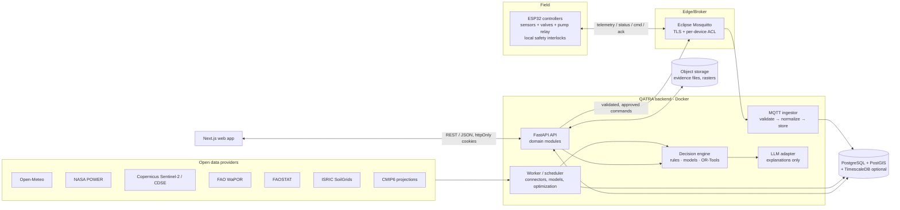
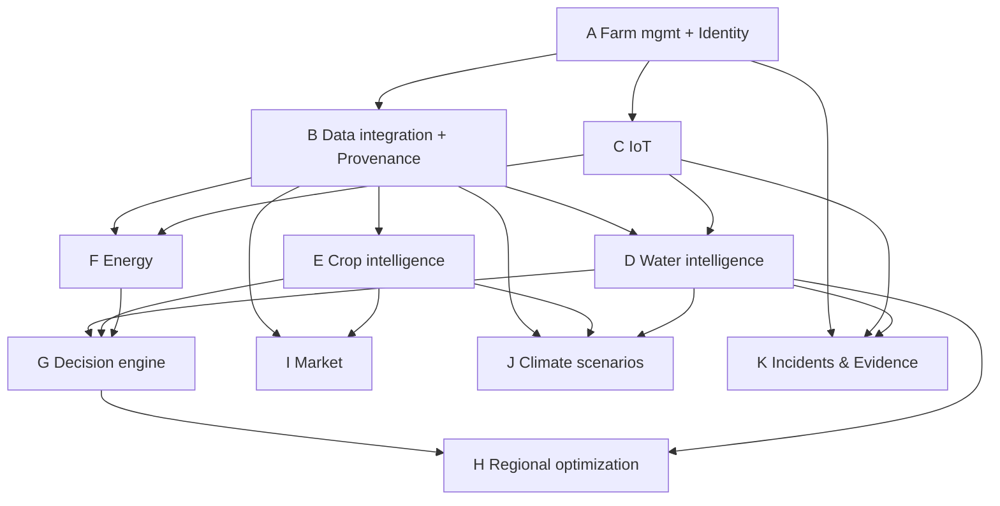
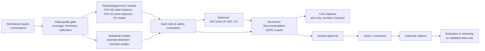

# QATRA — Technical Blueprint (v0.1, pre-implementation)

> Status: **proposal awaiting approval**. Nothing described here is implemented yet.
> Date: 2026-11-21

---

## 0. Repository analysis (Step 1)

- Working folder contains only an empty `.qodo/` directory: **greenfield project**, nothing to preserve.
- Dev machine: Windows 11, Node 22.14, Python 3.13.2, Docker 29, Git 2.48. No local PostgreSQL → database runs in Docker.
- ⚠️ The folder lives inside **OneDrive**. `node_modules`, `.venv`, Docker bind mounts and Postgres data inside a synced folder cause file-lock errors, slow installs and sync storms. Recommendation: move the repo to e.g. `C:\dev\qatra` and use Git (+ GitHub) for backup instead of OneDrive.

---

## 1. Product architecture

### 1.1 Guiding principles

1. **Modular monolith first.** One FastAPI service with strictly separated domain modules, one worker process, one database. Microservices only when a module has a real scaling/ownership reason. This keeps a small team fast while module boundaries keep future extraction possible.
2. **Deterministic core, AI at the edges.** Agronomic physics (FAO‑56 water balance, FAO‑33 yield response) and hard safety rules decide; statistical/ML models estimate; optimization allocates; the LLM only *explains* and *converses*. The LLM never produces numbers that aren't in the structured payload and never actuates hardware.
3. **Provenance is a column, not a comment.** Every measurement row carries its data class, source, quality status and method (see §7.4).
4. **Honest UI.** Unbuilt modules are shown as "planned", simulated data is visibly badged, missing data is shown as missing, recommendations can say "insufficient evidence".
5. **Tunisia first, international-ready.** Arabic (RTL) / French / English UI from day one; timezone, currency and units are per-farm configuration, never hard-coded.

### 1.2 System architecture



### 1.3 Runtime components (docker-compose)

| Service | Image / tech | Purpose |
|---|---|---|
| `db` | `timescale/timescaledb-ha` (ships PostGIS + TimescaleDB) | All relational, geospatial and time-series data |
| `api` | Python 3.12, FastAPI, Uvicorn | REST API, auth, RBAC, domain logic |
| `worker` | same codebase, APScheduler entrypoint | Data connectors, model runs, optimization, report generation |
| `mqtt-ingestor` | same codebase, `paho-mqtt`/`aiomqtt` entrypoint | Consumes telemetry, writes measurements, tracks device health (Phase 3) |
| `mosquitto` | `eclipse-mosquitto:2` | MQTT broker with password/ACL or dynamic-security plugin (Phase 3) |
| `web` | Next.js (Node 22) | UI |
| `minio` *(optional)* | S3-compatible | Evidence photos, raster tiles (Phase 5; local disk earlier) |

No Redis/Celery/Kafka initially: the worker uses APScheduler with a Postgres `jobs` table (idempotent jobs, retries). A queue can replace it later behind the same `JobRunner` interface.

### 1.4 Backend architecture (per-module layering)

```
module/
  models.py        SQLAlchemy ORM (+ GeoAlchemy2)
  schemas.py       Pydantic v2 request/response DTOs
  repository.py    DB access; ALWAYS applies farm-scope filter
  service.py       business logic, no HTTP, no SQL strings
  router.py        FastAPI endpoints, thin
  permissions.py   policy checks for this module
  tests/
```

Cross-module calls go through `service` interfaces only (no importing another module's repository). Shared kernel: `core/` (config, db session, security, provenance types, units, errors, logging, pagination).

### 1.5 Frontend architecture

- **Next.js (App Router) + TypeScript + Tailwind**; component primitives via shadcn/ui (copied into repo, no runtime dependency lock-in).
- **Data:** TanStack Query against a typed client **generated from the FastAPI OpenAPI schema** (`openapi-typescript`) → one source of truth for types.
- **Auth:** API sets httpOnly cookies; Next.js middleware protects routes; no tokens in `localStorage`, no API keys in frontend.
- **Maps:** Leaflet (`react-leaflet`) — free, no token. OSM tiles for development; a proper tile provider for production (OSM's public tiles are not for production load). Mapbox stays optional.
- **Charts:** Recharts.
- **i18n:** `next-intl` with `ar` (RTL), `fr`, `en`.
- **Shared UI concepts:** `<ProvenanceBadge>` (measured / official / farmer-reported / remote-sensed / inferred / simulated / projected), `<UncertaintyRange>`, `<MissingData>`, `<RecommendationCard>` (the 9-part structure), `<PlannedModule>`.

```
(auth)/login
(app)/overview
(app)/farms, /farms/[id], /farms/[id]/parcels/[pid], zones
(app)/monitoring            ← Phase 2–3
(app)/water                 ← Phase 3
(app)/crops                 ← Phase 4
(app)/energy                ← Phase 4
(app)/recommendations       ← Phase 4
(app)/regional              ← Phase 5
(app)/market                ← Phase 5
(app)/climate               ← Phase 5
(app)/incidents             ← Phase 5 (simple version possible earlier)
(app)/settings
```

### 1.6 Module dependencies



A and B are the foundation; G is the integrator; H, I, J consume everything else.

---

## 2. MVP scope and feature prioritization

**MVP = Phases 1–3**: a farmer/operator can register a farm with mapped parcels and irrigation zones, see real weather, see (simulated or real) sensor data with honest labels, and receive an **explainable FAO‑56-based irrigation recommendation per zone** with water-balance reasoning and anomaly flags. That is the smallest product that demonstrates "OBSERVE → REASON → ACT" on real data.

| Priority | Feature | Why now |
|---|---|---|
| P0 | Auth, roles, farm-scoped access | Everything depends on it |
| P0 | Farms / parcels / zones with geometry | Spatial anchor for all data |
| P0 | Provenance model | Retrofitting it later is expensive |
| P0 | Open-Meteo weather + ET0 | Free, high value, drives water balance |
| P0 | Crop reference data (FAO‑56 Kc, stages, root depth, p, Ky) | Needed for water requirement |
| P1 | Soil profiles (SoilGrids prior + manual override) | TAW/RAW for water balance |
| P1 | Simulated sensor generator (labeled) + ingestion API | Lets UI/logic be built before hardware |
| P1 | Water balance + irrigation recommendation | Core value |
| P1 | Mass-balance & statistical anomaly detection | Core "where is water lost" |
| P2 | MQTT + ESP32 contract, command lifecycle | Hardware-ready |
| P2 | Energy-aware scheduling (NASA POWER PV estimate) | Phase 4 |
| P3 | Crop suitability, regional optimization, market, climate, evidence passport | Phases 4–5 |

### Phase 1 acceptance criteria

1. `docker compose up` starts db, api, web; migrations + seed run with one command.
2. Seeded users exist for each role; login/logout/refresh work; passwords stored with Argon2id.
3. A farmer sees **only** their farms (verified by automated test returning 404 for others' farm IDs).
4. Farmer can create a farm, draw its boundary and parcels on the map, define irrigation zones within parcels; geometries are validated (valid polygon, zone ⊂ parcel ⊂ farm boundary with tolerance).
5. Overview shows real counts from DB; unbuilt metrics are explicitly "not yet available", not fake numbers.
6. OpenAPI docs at `/docs`; ≥ 80% backend test coverage on auth + farm modules; CI-style `make test` passes.
7. All seed data that isn't real is marked `data_class = 'simulated'` and badged in the UI.

---

## 3. Project folder structure

```
qatra/
├─ backend/
│  ├─ app/
│  │  ├─ main.py                  # FastAPI app factory
│  │  ├─ core/                    # config, db, security, logging, errors, units, provenance
│  │  ├─ modules/
│  │  │  ├─ identity/             # users, roles, auth, farm_members, audit
│  │  │  ├─ farms/                # farms, boundaries, parcels, zones, plantings
│  │  │  ├─ agronomy/             # crops, varieties, stages, soils (reference + farm)
│  │  │  ├─ data_sources/         # registry, ingestion runs, connectors/
│  │  │  │  └─ connectors/        # open_meteo.py, nasa_power.py, soilgrids.py, sentinel2.py, wapor.py, faostat.py
│  │  │  ├─ weather/
│  │  │  ├─ iot/                  # devices, sensors, calibrations, measurements, commands, mqtt/
│  │  │  ├─ water/                # resources, allocations, consumption, events, balance, anomalies
│  │  │  ├─ energy/
│  │  │  ├─ decisions/            # recommendation engine, rules, approvals, explanation (LLM adapter)
│  │  │  ├─ optimization/         # OR-Tools models, runs
│  │  │  ├─ market/
│  │  │  ├─ climate/
│  │  │  └─ evidence/             # incidents, evidence, consents, reports
│  │  ├─ workers/                 # scheduler.py, mqtt_ingestor.py, jobs/
│  │  └─ simulation/              # labeled synthetic data generators
│  ├─ migrations/                 # Alembic
│  ├─ seeds/                      # reference data (FAO-56 tables w/ citations) + demo data
│  ├─ tests/                      # unit/, integration/ (real PostGIS via docker)
│  ├─ pyproject.toml              # uv-managed; ruff, mypy, pytest config
│  └─ Dockerfile
├─ frontend/
│  ├─ src/app/                    # routes (see §1.5)
│  ├─ src/components/             # ui/, maps/, charts/, provenance/, recommendations/
│  ├─ src/lib/                    # api client (generated), auth, i18n, formatting/units
│  ├─ messages/                   # ar.json, fr.json, en.json
│  ├─ tests/                      # vitest; e2e/ (Playwright, later)
│  └─ Dockerfile
├─ firmware/                      # Phase 3: ESP32 (PlatformIO) reference firmware + MQTT contract
├─ infra/
│  ├─ docker-compose.yml
│  ├─ docker-compose.dev.yml
│  ├─ mosquitto/                  # config, ACL templates
│  └─ db/init/                    # extensions bootstrap
├─ docs/
│  ├─ BLUEPRINT.md  ARCHITECTURE.md  DATABASE.md  API_DOCUMENTATION.md  DEVELOPMENT_ROADMAP.md
│  └─ adr/                        # Architecture Decision Records
├─ .env.example
├─ Makefile                       # make up / migrate / seed / test / lint
└─ README.md
```

Tooling: **uv** (Python deps), **Alembic**, **GeoAlchemy2**, **ruff + mypy**, **pytest**; **pnpm**, **ESLint + Prettier**, **Vitest**, Playwright later.

---

## 4. Database ER diagram (core)

```mermaid
erDiagram
  users ||--o{ user_roles : has
  roles ||--o{ user_roles : grants
  users ||--o{ farm_members : member
  farms ||--o{ farm_members : has
  farms ||--o{ farm_boundaries : "versioned geometry"
  farms ||--o{ parcels : contains
  parcels ||--o{ irrigation_zones : contains
  parcels }o--o| soil_profiles : "has soil"
  soil_profiles ||--o{ soil_measurements : sampled
  crops ||--o{ crop_varieties : has
  crops ||--o{ crop_growth_stages : defines
  irrigation_zones ||--o{ crop_plantings : planted
  crop_varieties ||--o{ crop_plantings : uses
  farms ||--o{ devices : owns
  devices ||--o{ sensors : carries
  sensors ||--o{ sensor_calibrations : calibrated
  sensors ||--o{ sensor_measurements : produces
  devices ||--o{ device_commands : receives
  devices ||--o{ device_messages : logs
  irrigation_zones ||--o{ irrigation_events : irrigated
  farms ||--o{ water_resources : uses
  water_resources ||--o{ water_allocations : allocated
  water_resources ||--o{ water_consumption : metered
  water_resources ||--o{ water_anomalies : flagged
  farms ||--o{ energy_assets : has
  energy_assets ||--o{ energy_measurements : produces
  data_sources ||--o{ ingestion_runs : runs
  data_sources ||--o{ weather_observations : provides
  data_sources ||--o{ weather_forecasts : provides
  data_sources ||--o{ satellite_observations : provides
  farms ||--o{ ai_recommendations : receives
  ai_recommendations ||--o{ recommendation_evidence : cites
  ai_recommendations ||--o{ recommendation_decisions : "approved/rejected"
  optimization_runs ||--o{ optimization_allocations : outputs
  climate_scenarios ||--o{ scenario_runs : simulated
  farms ||--o{ incidents : reports
  incidents ||--o{ evidence_records : supported_by
  users ||--o{ consents : grants
  users ||--o{ audit_logs : acts
```



Additions to your requested list, and why:
- **`farm_members`** – farm-level authorization (a farmer owns, an operator is assigned, an analyst may be read-only).
- **`crop_plantings`** – links a zone to a variety for a season with planting date; growth stage is *derived* from it. Without it, "growth stage" has no anchor.
- **`data_sources`, `ingestion_runs`** – provenance backbone.
- **`sensor_calibrations`, `device_commands`, `device_messages`** – calibration history, command lifecycle with acks, communication logs.
- **`water_anomalies`, `energy_assets`, `recommendation_evidence`, `recommendation_decisions`, `optimization_allocations`, `scenario_runs`, `planting_intentions`, `consents`** – needed to satisfy explainability, approvals and evidence requirements.

---

## 5. Core database schema

Conventions: `id UUID PK` (uuid v7 for index locality) unless noted; all timestamps `timestamptz` in UTC; `created_at/updated_at` on business entities; time-series tables are append-only (no `updated_at`, corrections are new rows that reference the original). Geometry SRID 4326; areas computed via `geography` casts. Canonical units are stored (see §7.3).

### 5.1 Shared enums

```sql
data_class      : measured | official | farmer_reported | remote_sensed | inferred | simulated | projected
quality_status  : raw | valid | suspect | invalid | corrected | gap_filled
calibration_status : calibrated | factory_default | uncalibrated | expired
role_name       : admin | farmer | operator | analyst
farm_role       : owner | operator | viewer
```

### 5.2 Identity & audit (Phase 1)

```sql
users(id, email CITEXT UNIQUE, password_hash TEXT, full_name, phone, locale DEFAULT 'fr',
      is_active BOOL, last_login_at, created_at, updated_at)
roles(id SMALLINT PK, name role_name UNIQUE, description)
user_roles(user_id FK users, role_id FK roles, PK(user_id, role_id))
refresh_tokens(id, user_id FK, token_hash TEXT UNIQUE, expires_at, revoked_at, replaced_by FK refresh_tokens, user_agent, ip INET, created_at)
farm_members(farm_id FK farms, user_id FK users, farm_role, granted_by FK users, created_at,
             PK(farm_id, user_id))                          IDX(user_id)
audit_logs(id BIGSERIAL, actor_user_id FK NULL, actor_type ('user'|'system'|'device'), action TEXT,
           entity_type, entity_id, farm_id NULL, before JSONB, after JSONB, ip INET, request_id, created_at)
           IDX(entity_type, entity_id), IDX(farm_id, created_at DESC)   -- INSERT-only via DB grants
```

### 5.3 Farms, geography, agronomy (Phase 1–2)

```sql
farms(id, name, code UNIQUE, governorate, delegation, country_code CHAR(2) DEFAULT 'TN',
      timezone DEFAULT 'Africa/Tunis', currency CHAR(3) DEFAULT 'TND',
      centroid geometry(Point,4326), elevation_m NUMERIC, irrigation_scheme TEXT NULL,  -- e.g. GDA / public perimeter
      data_class DEFAULT 'farmer_reported', created_at, updated_at)
      GIST(centroid)
farm_boundaries(id, farm_id FK, geom geometry(MultiPolygon,4326), area_ha NUMERIC GENERATED,
      valid_from, valid_to NULL, source_id FK data_sources, created_by FK users, created_at)
      GIST(geom), UNIQUE(farm_id) WHERE valid_to IS NULL
parcels(id, farm_id FK, name, geom geometry(MultiPolygon,4326), area_ha, slope_pct NULL,
      soil_profile_id FK NULL, land_tenure NULL, created_at, updated_at)   GIST(geom), IDX(farm_id)
irrigation_zones(id, parcel_id FK, name, geom geometry(MultiPolygon,4326) NULL, area_ha,
      irrigation_method ('drip'|'sprinkler'|'surface'|'pivot'|'none'), emitter_flow_lph NULL,
      emitters_per_m2 NULL, application_efficiency NUMERIC(3,2), design_flow_m3h NULL,
      water_resource_id FK NULL, created_at, updated_at)                   IDX(parcel_id)
crops(id, code UNIQUE, name_en, name_fr, name_ar, family, category ('cereal'|'vegetable'|'tree'|'forage'|...),
      kc_ini, kc_mid, kc_end, root_depth_min_m, root_depth_max_m, depletion_fraction_p,
      ky_total, salinity_threshold_ecE NULL, reference_citation TEXT, created_at, updated_at)
crop_varieties(id, crop_id FK, name, cycle_days, notes, source_citation, created_at, updated_at)
crop_growth_stages(id, crop_id FK, variety_id FK NULL, stage ('initial'|'development'|'mid'|'late'),
      seq SMALLINT, duration_days, kc_start, kc_end, ky_stage, water_stress_sensitivity, citation)
      UNIQUE(crop_id, variety_id, seq)
crop_plantings(id, zone_id FK, variety_id FK, season_label, planting_date, expected_harvest_date,
      actual_harvest_date NULL, status ('planned'|'active'|'harvested'|'failed'),
      reported_yield_t_ha NULL, yield_data_class, created_at, updated_at)   IDX(zone_id, status)
soil_profiles(id, name, texture_class, sand_pct, silt_pct, clay_pct, organic_carbon_pct,
      field_capacity_vol, wilting_point_vol, bulk_density, ec_dS_m NULL, ph NULL, depth_m,
      data_class, source_id FK, method TEXT, created_at, updated_at)
soil_measurements(id, parcel_id FK, sampled_at, depth_cm, parameter, value, unit,
      data_class, source_id FK, lab_name NULL, method, quality_status, created_at)
```

### 5.4 Provenance & external data (Phase 2)

```sql
data_sources(id, code UNIQUE ('open_meteo','nasa_power','soilgrids','sentinel2_cdse','wapor','faostat','sim','farmer','device'),
      name, provider, kind ('api'|'device'|'manual'|'model'|'simulator'), license TEXT, terms_url,
      spatial_resolution TEXT, temporal_resolution TEXT, methodology_url, created_at, updated_at)
ingestion_runs(id, source_id FK, started_at, finished_at, status ('ok'|'partial'|'failed'),
      request_params JSONB, records_in, records_stored, error TEXT, cache_key, created_at)
weather_observations(time, location_id/farm_id FK, source_id FK, ingestion_run_id FK,
      variable ('t2m'|'rh'|'precip'|'wind10m'|'sw_rad'|'et0'|...), value DOUBLE, unit,
      data_class, quality_status, resolution_km NUMERIC, PK(farm_id, variable, time, source_id))   -- hypertable
weather_forecasts(issued_at, valid_time, farm_id FK, source_id FK, model TEXT, variable, value, unit,
      PK(farm_id, variable, issued_at, valid_time, source_id))                                      -- hypertable
satellite_observations(id, parcel_id FK, acquired_at, source_id FK, product ('S2_L2A'), index ('ndvi'|'ndmi'|...),
      mean, p10, p90, valid_pixel_pct, cloud_pct, pixel_count, method, quality_status, created_at)
```

### 5.5 IoT (Phase 2 simulated, Phase 3 real)

```sql
devices(id, farm_id FK, serial UNIQUE, kind ('esp32_controller'|'gateway'), firmware_version,
      location geometry(Point,4326), zone_id FK NULL, mqtt_client_id UNIQUE, credential_hash,
      status ('provisioned'|'online'|'offline'|'retired'), last_seen_at, is_simulated BOOL,
      created_at, updated_at)                                   IDX(farm_id), GIST(location)
sensors(id, device_id FK, zone_id FK NULL, channel, measurand ('soil_moisture'|'soil_temp'|'air_temp'|'humidity'|
      'flow'|'pressure'|'tank_level'|'pv_power'|'battery_soc'|'pump_state'), unit, depth_cm NULL,
      model, min_valid, max_valid, max_rate_per_min NULL, is_simulated BOOL, installed_at, removed_at,
      created_at, updated_at)                                   UNIQUE(device_id, channel, installed_at)
sensor_calibrations(id, sensor_id FK, method ('factory'|'gravimetric'|'two_point'|'lab'), coefficients JSONB,
      performed_at, performed_by, valid_until, status calibration_status, notes, created_at)
sensor_measurements(time, sensor_id FK, value DOUBLE, raw_value DOUBLE, unit, quality_status,
      calibration_id FK NULL, data_class, ingest_msg_id, PK(sensor_id, time))   -- hypertable, compressed > 7d
device_messages(id BIGSERIAL, device_id FK, direction ('in'|'out'), topic, payload JSONB, msg_id, received_at)
      -- retention 90 days
device_commands(id, device_id FK, zone_id FK, command ('open_valve'|'close_valve'|'pump_on'|'pump_off'|'run_zone'),
      params JSONB, max_duration_s INT, requested_by FK users, recommendation_id FK NULL,
      status ('requested'|'rejected'|'approved'|'sent'|'acked'|'executing'|'completed'|'failed'|'expired'),
      validation_report JSONB, nonce, expires_at, sent_at, acked_at, completed_at, created_at, updated_at)
```

### 5.6 Water & energy (Phase 3–4)

```sql
water_resources(id, farm_id FK NULL, scheme_id NULL, kind ('well'|'borehole'|'tank'|'basin'|'canal_turnout'|'network_connection'),
      name, location geometry(Point,4326), capacity_m3 NULL, max_flow_m3h NULL, depth_m NULL,
      elevation_m NULL, permit_ref NULL, created_at, updated_at)
water_allocations(id, water_resource_id FK, farm_id FK, period_start, period_end, volume_m3,
      allocating_body TEXT, data_class, source_id, created_at, updated_at)
water_consumption(time, water_resource_id FK, zone_id FK NULL, volume_m3, method ('meter'|'flow_integration'|'estimated'),
      data_class, quality_status, PK(water_resource_id, time))     -- hypertable
irrigation_events(id, zone_id FK, started_at, ended_at, planned_volume_m3, delivered_volume_m3 NULL,
      source ('manual'|'schedule'|'command'|'detected'), command_id FK NULL, data_class, created_at)
water_anomalies(id, farm_id FK, water_resource_id FK NULL, zone_id FK NULL, detected_at, window_start, window_end,
      kind ('mass_balance_gap'|'unexpected_flow'|'pressure_drop'|'night_flow'|'sensor_drift'|'meter_stuck'),
      estimated_loss_m3, severity ('low'|'medium'|'high'), confidence NUMERIC(3,2),
      hypotheses JSONB,  -- [{cause:'possible leak', evidence:[...], likelihood:'medium'}]  NEVER 'theft' as a conclusion
      status ('open'|'acknowledged'|'resolved'|'false_positive'), resolved_note, created_at, updated_at)
energy_assets(id, farm_id FK, kind ('pv_array'|'battery'|'pump'|'grid_connection'|'genset'),
      rated_kw NULL, capacity_kwh NULL, tilt_deg NULL, azimuth_deg NULL, efficiency NULL, specs JSONB, created_at, updated_at)
energy_measurements(time, energy_asset_id FK, variable ('power_kw'|'energy_kwh'|'soc_pct'|'grid_available'),
      value, unit, data_class, quality_status, PK(energy_asset_id, variable, time))  -- hypertable
```

### 5.7 Decisions, optimization (Phase 4–5)

```sql
ai_recommendations(id, farm_id FK, zone_id FK NULL, type ('irrigate'|'delay'|'reduce'|'stop'|'inspect_anomaly'|'crop_choice'|...),
      status ('draft'|'pending_approval'|'approved'|'rejected'|'executed'|'expired'|'superseded'),
      action JSONB, reasoning JSONB, expected_benefits JSONB, risks JSONB, alternatives JSONB,
      confidence ('low'|'medium'|'high'|'insufficient_evidence'), uncertainty JSONB,
      requires_human_approval BOOL, engine_version, inputs_snapshot JSONB, explanation_text TEXT NULL,
      explanation_model NULL, valid_from, valid_until, created_at, updated_at)   IDX(farm_id, created_at DESC)
recommendation_evidence(id, recommendation_id FK, kind ('measurement'|'forecast'|'reference'|'model_output'),
      entity_ref JSONB, value, unit, data_class, source_id FK, observed_at)
recommendation_decisions(id, recommendation_id FK, decided_by FK users, decision ('approved'|'rejected'|'modified'),
      comment, modified_action JSONB, decided_at)
recommendation_outcomes(id, recommendation_id FK, observed_at, metric, value, unit, data_class, notes)  -- the LEARN loop
optimization_runs(id, scope ('farm'|'scheme'|'region'), scope_ref, policy ('equal_share'|'crop_priority'|'min_damage'|'custom'),
      policy_params JSONB, inputs_snapshot JSONB, solver ('cp_sat'|'glop'), status, objective_value,
      fairness_metrics JSONB, assumptions JSONB, created_by FK, started_at, finished_at, created_at)
optimization_allocations(id, run_id FK, farm_id FK, zone_id FK NULL, demand_m3, allocated_m3,
      share_of_demand, est_yield_loss_pct, slot_start NULL, slot_end NULL)
```

### 5.8 Market, climate, evidence (Phase 5)

```sql
market_prices(id, commodity_code, market_name, region, observed_on, price, currency, unit ('kg'|'t'|'box'),
      price_type ('wholesale'|'retail'|'farmgate'|'producer_annual'), data_class, source_id, created_at)
      IDX(commodity_code, observed_on)
market_observations(id, commodity_code, region, period_start, period_end, metric ('production'|'imports'|'exports'|'stocks'|'arrivals'),
      value, unit, data_class, source_id, created_at)
planting_intentions(id, farm_id FK, season_label, crop_id FK, area_ha, declared_at, is_anonymized_share_ok BOOL)
climate_scenarios(id, name, kind ('historical_baseline'|'cmip6_projection'|'hypothetical'), ssp NULL, horizon ('2030'|'2050'|'2080'),
      params JSONB  -- e.g. {rain_delta_pct:-20, temp_delta_c:+2, drought_months:4, groundwater_delta_pct:-15}
      , source_id NULL, created_by FK, created_at, updated_at)
scenario_runs(id, scenario_id FK, scope_ref, results JSONB, model_version, created_at)
incidents(id, farm_id FK, reported_by FK users, kind ('delivery_interruption'|'pump_downtime'|'maintenance_request'|'leak_report'|'crop_damage'|'other'),
      started_at, ended_at NULL, description, location geometry(Point,4326) NULL,
      verification_status ('reported'|'corroborated_by_sensor'|'verified_by_third_party'|'disputed'),
      created_at, updated_at)
evidence_records(id, incident_id FK, kind ('sensor_extract'|'photo'|'document'|'communication'|'statement'),
      data_class, file_uri NULL, sha256 CHAR(64) NULL, captured_at, captured_by, linked_measurements JSONB,
      calibration_snapshot JSONB, supersedes_id FK evidence_records NULL, created_at)   -- append-only
consents(id, user_id FK, farm_id FK, purpose ('evidence_sharing'|'regional_aggregation'|'research'), granted_at, revoked_at, scope JSONB)
```

### 5.9 TimescaleDB policy
Hypertables for `sensor_measurements`, `weather_observations`, `weather_forecasts`, `water_consumption`, `energy_measurements`. The migration checks `pg_extension`; if TimescaleDB is absent the tables remain normal tables with BRIN indexes on `time` — the app works either way. Continuous aggregates (hourly/daily) added in Phase 3.

---

## 6. Main API endpoints (`/api/v1`)

| Area | Endpoints | Phase |
|---|---|---|
| Auth | `POST /auth/login`, `POST /auth/refresh`, `POST /auth/logout`, `GET /auth/me` | 1 |
| Users (admin) | `GET/POST /users`, `PATCH /users/{id}`, `PUT /users/{id}/roles` | 1 |
| Farms | `GET/POST /farms`, `GET/PATCH/DELETE /farms/{id}`, `PUT /farms/{id}/boundary`, `GET/POST/DELETE /farms/{id}/members` | 1 |
| Parcels & zones | `GET/POST /farms/{id}/parcels`, `GET/PATCH/DELETE /parcels/{id}`, `GET/POST /parcels/{id}/zones`, `PATCH/DELETE /zones/{id}` | 1 |
| Geo export | `GET /farms/{id}/geojson` | 1 |
| Overview | `GET /overview` (role-scoped KPIs, each with provenance + availability flag) | 1 |
| Agronomy | `GET /crops`, `GET /crops/{id}`, `GET /soils`, `POST /parcels/{id}/soil-profile`, `GET/POST /zones/{id}/plantings` | 2 |
| Weather | `GET /farms/{id}/weather/observations?from&to&vars`, `GET /farms/{id}/weather/forecast`, `POST /farms/{id}/weather/refresh` | 2 |
| Data sources | `GET /data-sources`, `GET /ingestion-runs?source=` | 2 |
| Devices & sensors | `GET/POST /farms/{id}/devices`, `GET /devices/{id}/health`, `GET/POST /devices/{id}/sensors`, `POST /sensors/{id}/calibrations` | 2–3 |
| Measurements | `GET /sensors/{id}/measurements?from&to&agg=1h`, `POST /ingest/measurements` (device-auth, batch, idempotent) | 2–3 |
| Simulation | `POST /admin/simulation/run` (writes `data_class=simulated` only) | 2 |
| Water | `GET /farms/{id}/water/balance?zone=`, `GET /farms/{id}/water/consumption`, `GET/POST /water-resources`, `GET/POST /water-allocations`, `GET/POST /zones/{id}/irrigation-events`, `GET/PATCH /water/anomalies` | 3 |
| Irrigation | `GET /farms/{id}/irrigation/recommendations`, `POST /farms/{id}/irrigation/schedule:plan` | 3 |
| Commands | `POST /devices/{id}/commands` (→ validation → approval), `POST /commands/{id}/approve`, `POST /commands/{id}/cancel`, `GET /commands/{id}` | 3 |
| Recommendations | `GET /recommendations`, `GET /recommendations/{id}`, `POST /recommendations/{id}/decision`, `POST /recommendations/{id}/explain` (LLM), `POST /recommendations/{id}/outcomes` | 4 |
| Crop planning | `POST /parcels/{id}/crop-suitability` | 4 |
| Energy | `GET /farms/{id}/energy/forecast`, `GET /farms/{id}/energy/windows` | 4 |
| Optimization | `POST /optimization/runs`, `GET /optimization/runs/{id}`, `GET /optimization/runs/{id}/compare?with=` | 4–5 |
| Market | `GET /market/prices`, `GET /market/commodities/{code}/outlook`, `POST /market/supply-scenarios` | 5 |
| Climate | `GET/POST /climate/scenarios`, `POST /climate/scenarios/{id}/run` | 5 |
| Evidence | `GET/POST /farms/{id}/incidents`, `POST /incidents/{id}/evidence`, `GET /incidents/{id}/report.pdf`, `POST /evidence/{id}/corrections`, `GET/POST /consents` | 5 |
| Assistant | `POST /assistant/chat` (LLM with read-only tools scoped to user's farms) | 4 |
| Ops | `GET /health`, `GET /ready`, `GET /metrics` | 1 |

Conventions: cursor pagination; RFC 9457 `application/problem+json` errors; `X-Request-ID` propagated to logs; every measurement response includes `{value, unit, data_class, source, observed_at, quality_status}`.

### MQTT contract (Phase 3)

```
qatra/v1/{farm_id}/{device_id}/telemetry   device → broker   QoS1, batched, msg_id for idempotency
qatra/v1/{farm_id}/{device_id}/status      device → broker   retained, Last-Will = offline
qatra/v1/{farm_id}/{device_id}/cmd         broker → device   QoS1, {cmd_id, nonce, expires_at, max_duration_s, hmac}
qatra/v1/{farm_id}/{device_id}/ack         device → broker   {cmd_id, state: received|executing|done|refused, reason}
```
Broker ACL: a device can only publish to its own `telemetry/status/ack` and subscribe to its own `cmd`.

---

## 7. Data-source integration strategy

### 7.1 Connector pattern

```python
class Connector(Protocol):
    source_code: str
    def fetch(self, req: FetchRequest) -> RawPayload        # HTTP with timeout, retry w/ exponential backoff + jitter, rate-limit token bucket
    def validate(self, raw) -> ValidatedBatch                # schema + physical bounds
    def normalize(self, batch) -> list[NormalizedRecord]     # canonical units, UTC, geo ref, provenance attached
```
Each run writes an `ingestion_runs` row; responses cached on disk/DB keyed by (source, params, day). Failures degrade gracefully: the UI shows "last updated N hours ago", decisions downgrade confidence or return `insufficient_evidence`.

### 7.2 Sources

| Source | What we use | Resolution | Phase | Access & caveats |
|---|---|---|---|---|
| **Open-Meteo** | Forecast (16 d), historical/ERA5 archive, **FAO‑56 ET0**, precipitation, radiation; Climate API (CMIP6) | ~1–11 km (model-dependent); ERA5 ~25 km | 2 | Free API is **non-commercial only**; a commercial deployment needs a paid plan or self-hosting (open-source). Decide before launch. |
| **NASA POWER** | Daily solar irradiance, temperature, for PV yield estimation | 0.5° × 0.625° | 4 | Free, no key; coarse — fine for PV energy, not for microclimate. |
| **ISRIC SoilGrids** | Texture, OC, bulk density → FC/WP via pedotransfer | 250 m | 2 | Free (CC‑BY). Model estimate → `data_class=inferred`; farmer lab results override. |
| **FAO‑56 / FAO‑33 tables** | Kc, stage lengths, root depth, p, Ky | reference | 2 | Published reference; stored with citations. Local calibration needed for Tunisian varieties. |
| **Copernicus Sentinel‑2** (via Copernicus Data Space Ecosystem) | NDVI/NDMI per parcel, L2A + cloud mask | 10–20 m, ~5 days | 5 | Free account; processing quotas. Small parcels (< 0.5 ha) give few clean pixels → report `valid_pixel_pct`. |
| **FAO WaPOR v3** | Actual ET & interception (AETI), biomass, water productivity | 300 m / 100 m (coverage to verify per area) | 5 | Free; dekadal; used for regional benchmarking, not per-zone irrigation. |
| **FAOSTAT** | National production, area, yield, trade, annual producer prices | country/year | 5 | Free; too coarse for short-term price forecasting. |
| **CMIP6 projections** (Copernicus CDS or NASA NEX‑GDDP‑CMIP6) | Temperature/precipitation change for SSP scenarios | ~25 km downscaled | 5 | Free; must be labeled `projected`, with ensemble spread. |
| **Copernicus DEM GLO‑30** | Elevation for gravity-feed pre-screening | 30 m | 4 | Free; only a screening input, never proof of hydraulic feasibility. |
| **Tunisian institutional data** (e.g., ONAGRI, INS, CRDA, GDAs, INM) | Local market prices, allocations, station weather | varies | 5+ | Availability, format and terms **must be verified / negotiated**; not assumed. |

### 7.3 Canonical units
Water depth mm; volume m³; flow m³/h; pressure kPa; soil moisture m³/m³ (volumetric); temperature °C; irradiance W/m²; energy kWh; power kW; area ha; money as `(amount NUMERIC, currency CHAR(3))`. Conversion happens once, in `core/units.py`, with tests.

### 7.4 Provenance on every measurement
`data_class`, `source_id`, `ingestion_run_id` or device/sensor id, `observed_at`, location (farm/parcel/zone or geometry), `unit`, `quality_status`, `calibration_id` (if applicable), `method`. Aggregates inherit the "weakest" class of their inputs (e.g., measured + simulated → shown as **mixed**, with breakdown).

### 7.5 What's free vs. what needs the field / partners

| Capability | Free open data is enough | Needs real sensors / field data | Needs partnerships |
|---|---|---|---|
| Weather, ET0, forecast | ✅ | Local station improves accuracy | INM stations (optional) |
| FAO‑56 water balance | ✅ (as estimate) | Soil-moisture sensors to validate & correct | — |
| Soil properties | ✅ SoilGrids prior | Lab soil analysis | Labs/CRDA |
| Leak / anomaly detection | ❌ | Flow + pressure meters (inlet/outlet) | Scheme operators for network data |
| Pump/energy scheduling | ✅ PV estimate | Power/SOC measurements | STEG outage data (optional) |
| Crop suitability | ✅ partial (climate, soil prior, FAO tables) | Local yield records | Extension services / research institutes |
| Regional allocation | ❌ (only demo w/ synthetic farms) | Farm demand data | **GDA / CRDA allocation data and governance** |
| Market outlook | ⚠️ FAOSTAT annual only | — | Wholesale market price series (e.g., ONAGRI) |
| Climate 2050 | ✅ CMIP6 | — | — |
| Evidence passport | — | Sensor data + calibration | Legal advice on use |
| ML models (yield, demand) | ❌ | Multi-season labeled field data | Pilot farms |

---

## 8. AI/ML architecture



| Problem | Technique | Rationale |
|---|---|---|
| Crop water requirement | FAO‑56: ETc = Kc(stage) × ET0; dual Kc later for drip | Standard, explainable, no training data needed |
| Soil water state | Daily root-zone depletion bucket (TAW, RAW from soil FC/WP & root depth, effective rain, irrigation, drainage); **assimilate sensor readings** when calibrated sensors exist (simple bias correction → Kalman filter later) | Works with zero sensors; improves with sensors |
| Irrigation decision | Depletion vs RAW threshold + 1–3‑day forecast rain/ET0 + stage sensitivity + allocation remaining + energy window → `irrigate / delay / reduce / stop` | Each factor appears as a line in the reasoning |
| Leak/anomaly | Mass balance (inlet − outlet − expected), residual vs expected flow from schedule, night-flow, pressure-drop rules, robust z-score/MAD & CUSUM; Isolation Forest only after enough history | Interpretable; produces hypotheses + evidence, never verdicts |
| Multi-zone scheduling | OR-Tools **CP-SAT**: binary zone×slot variables; constraints: pump capacity, max simultaneous zones, energy available per slot (PV forecast + battery), tank level; objective: minimize weighted water-stress deficit | Exact, fast for farm-scale problems |
| Regional allocation | LP (GLOP) / CP-SAT; policies: equal share, crop priority, **min. estimated damage using Ky** (1 − Ya/Ym = Ky(1 − ETa/ETc)), custom weights; outputs fairness metrics (min share, Gini, per-farm deltas vs equal share) | Transparent trade-offs, comparable policies |
| Crop suitability | Multi-criteria **profile, not a single score**: per-factor ratings (climate, soil, water need vs available, energy, salinity, market risk) each with data class + missing-data flags; optional Pareto front (profit vs water) | Matches "no single arbitrary score" requirement |
| Market | Seasonal baselines, quantile ranges with backtest metrics shown; supply-shift scenario: Δsupply from aggregated planting intentions × assumed elasticity range → price pressure band | Shows ranges, never guarantees |
| Climate 2050 | Re-run water balance & suitability with CMIP6 deltas or user-defined hypothetical deltas; ensemble spread shown | Clear separation: historical / projected / hypothetical |
| Explanations & chat | LLM via provider-agnostic adapter; input = structured recommendation JSON; output validated (every number in text must exist in payload, else regenerate/fallback to template). Chat uses **read-only** tools scoped to the user's farms. | LLM never invents data nor actuates |
| Learning | `recommendation_outcomes` + decisions → evaluation dashboards; ML models (e.g., XGBoost for yield or demand) introduced only once ≥ 2 seasons of validated data exist; versioned in a `model_versions` table | Honest "learn" loop |

**Insufficient evidence rule:** if required inputs are missing, stale (e.g., forecast > 24 h old), uncalibrated beyond tolerance, or contradictory, the engine returns `confidence = insufficient_evidence` with the list of what's missing — no recommendation is fabricated.

**Recommendation payload (contract):**
```json
{
  "action": {"type": "reduce", "zone_id": "...", "volume_mm": 6, "window": "2026-11-22T04:00/07:00"},
  "reasoning": ["Root-zone depletion 58% of TAW (RAW threshold 50%)", "4 mm rain forecast in 36 h (prob. 60%)", "..."],
  "supporting_data": [{"metric": "soil_moisture", "value": 0.18, "unit": "m3/m3", "data_class": "measured", "source": "sensor S-12", "observed_at": "..."}],
  "data_sources": ["open_meteo", "sensor:S-12", "fao56:tomato"],
  "confidence": "medium", "uncertainty": {"et0_mm": [4.1, 5.0]},
  "expected_benefits": ["Saves ~18 m³ vs full irrigation"],
  "risks": ["If rain does not occur, stress risk at flowering"],
  "alternatives": [{"type": "irrigate_full", "tradeoff": "..."}, {"type": "delay_24h", "tradeoff": "..."}],
  "requires_human_approval": true
}
```

---

## 9. Security architecture

- **Authentication:** Argon2id password hashes; short-lived JWT access token (15 min) + rotating refresh token (stored hashed, reuse detection revokes the family); both in `httpOnly; Secure; SameSite=Lax` cookies; CSRF double-submit token on state-changing requests; login rate-limiting and lockout backoff.
- **Authorization:** global role (admin/farmer/operator/analyst) **plus** farm-level membership. Every repository query is farm-scoped through a single `FarmScope` dependency; tests assert cross-farm access returns 404. Analysts get only aggregated/anonymized regional data unless explicitly granted. Postgres Row-Level Security as a defense-in-depth option in Phase 4.
- **Audit:** append-only `audit_logs` for auth events, permission changes, commands, approvals, evidence changes.
- **API hardening:** Pydantic validation everywhere, strict CORS (web origin only), request size limits, security headers, no stack traces in responses, dependency scanning (pip-audit, pnpm audit).
- **Secrets:** `.env` (never committed), `.env.example` documented; LLM/API keys only on the backend.
- **IoT:**
  - Per-device credentials (Mosquitto dynamic-security or TLS client certs), TLS on the broker, per-device topic ACLs.
  - Command pipeline: request → **validation** (device online, sensor sanity, tank level ≥ min, pressure in range, allocation remaining, max duration, no conflicting command) → **human approval** (default for all actuation; auto-approve only under explicit, scoped, user-configured policies later) → signed message (HMAC, nonce, expiry) → device ack → completion/timeout.
  - **Firmware-side safety is mandatory and independent of the cloud:** hard max run time, dry-run/low-tank cutoff, over/under-pressure cutoff, watchdog that closes valves on connectivity loss, rejects expired/duplicate commands, manual override switch.
  - The LLM has no tool that can create commands.
- **Evidence & privacy:** farmer owns their incident data; explicit `consents` for sharing; SHA‑256 hashes of evidence files; corrections are new versions, originals retained; reports state their limits (no claim of legal admissibility). Compliance review against Tunisia's personal data law (Organic Law 2004‑63 / INPDP) and GDPR if operating in the EU.

---

## 10. Development phases and deliverables

| Phase | Deliverables | Exit criteria |
|---|---|---|
| **1 Foundation** | Repo scaffold, Docker Compose, Alembic migrations (identity, farms, agronomy skeleton, provenance enums), auth + RBAC + farm scoping, farm/parcel/zone CRUD with map drawing, overview page (honest KPIs), seed data, i18n shell, CI script, docs | §2 acceptance criteria pass |
| **2 Data integration** | `data_sources`/`ingestion_runs`, Open-Meteo connector (obs + forecast + ET0) with cache/retry, SoilGrids soil prior, FAO‑56 crop reference seeds with citations, plantings & growth stage derivation, simulated sensor generator, measurement API, provenance badges, weather & sensor charts | Weather for every seeded farm refreshed by worker; all simulated data badged; connector failure tested |
| **3 Irrigation intelligence** | Daily water balance per zone, irrigation recommendations (rule-based, explained), consumption tracking, anomaly detection v1, multi-zone schedule (CP-SAT), Mosquitto + ingestor, device registry/health, command lifecycle, ESP32 reference firmware + MQTT contract (bench-tested only) | Water balance unit-tested against FAO‑56 worked examples; simulated leak scenarios detected; command pipeline refuses unsafe commands in tests |
| **4 Decision intelligence** | Recommendation store + approval workflow + history, LLM explainer with number validation, assistant (read-only tools), crop suitability profiles, energy forecast (NASA POWER PV) and energy-aware scheduling, farm-level allocation | Every recommendation shows the 9 parts; LLM-off mode still works (template explanations) |
| **5 Advanced** | Sentinel‑2 parcel indices, WaPOR benchmarks, regional optimization with policy comparison & fairness metrics, market module with supply-shift scenarios, climate scenario simulator, incidents & evidence passport (PDF reports), advanced analytics | Each feature labeled with data classes; scenario outputs never shown as forecasts |

---

## 11. Main technical risks & mitigations

| Risk | Impact | Mitigation |
|---|---|---|
| No ground-truth data in Tunisia (soil, yields, allocations) | Recommendations unvalidated | Physics-based models first; confidence downgrades; pilot farms with sensors; outcome capture from day one |
| Open-Meteo non-commercial license | Legal blocker at commercialization | Abstract weather provider; budget paid plan or self-hosted Open-Meteo; alternative: ERA5 + local stations |
| Low-cost soil-moisture sensors (capacitive) drift and need soil-specific calibration | Wrong irrigation decisions | Calibration table + status; treat uncalibrated readings as trend-only; flag drift via water-balance residuals |
| Rural connectivity & power outages | Data gaps, missed commands | ESP32 store-and-forward, QoS1, batched telemetry, local schedules with safety; gaps shown, not interpolated silently |
| Unsafe actuation | Crop/equipment damage, water waste | Firmware interlocks independent of cloud; human approval default; signed, expiring commands |
| LLM hallucination | Loss of trust | LLM only verbalizes structured payload; numeric validation; template fallback; no actuation tools |
| Optimization outputs read as "fair"/authoritative | Social & legal conflict | Show policy, assumptions, winners/losers, fairness metrics; label "decision support, not an allocation order" |
| Anomaly flagged as theft | Harm to individuals | Hypotheses + evidence + confidence only; vocabulary rules enforced in code & copy |
| Small/fragmented parcels vs 10 m satellite pixels | Noisy indices | Pixel-count & cloud thresholds; parcel-level aggregation only when enough valid pixels |
| Collective-action market effects | Recommending the same crop to everyone crashes prices | Aggregate planting intentions; supply-shift scenarios; diversification signals |
| Scope creep (11 modules) | Nothing finished | Strict phase gates; modules hidden until usable |
| OneDrive-hosted repo on Windows | Build/DB corruption, slowness | Move repo out of OneDrive; run DB in a named Docker volume |
| Python 3.13 + geo/OR-Tools wheels | Install friction | Pin Python 3.12 in Docker; local dev via `uv` with same version |

---

## 12. Realistic implementation sequence (Phase 1 in detail)

Assuming one developer working with me; estimates are rough.

1. **Repo & tooling (½ day):** git init, folder skeleton, Makefile, `.env.example`, pre-commit (ruff, prettier), `infra/docker-compose.yml` with `db` (PostGIS+Timescale), `api`, `web`.
2. **Backend core (1 day):** settings (pydantic-settings), structured JSON logging with request IDs, DB session, error handlers (problem+json), health endpoints, test harness against real PostGIS container.
3. **Migrations v1 (1 day):** extensions, enums, identity tables, farms/boundaries/parcels/zones, data_sources, audit_logs; seed script (roles, demo users, 3 demo farms in different Tunisian governorates with clearly **simulated** geometry & attributes).
4. **Auth & RBAC (1½ days):** login/refresh/logout, cookie handling, CSRF, role guards, `FarmScope` dependency, audit hooks; tests for each role & cross-farm denial.
5. **Farm domain (2 days):** CRUD for farms, boundaries (versioned), parcels, zones with geometry validation and containment checks; GeoJSON export; tests.
6. **Frontend shell (1½ days):** Next.js app, Tailwind theme (deep/natural greens, earth neutrals), layout with 12-item nav (unbuilt items marked "planned"), i18n ar/fr/en with RTL, login, generated API client, auth middleware.
7. **Farm UI (2 days):** farm list + map, farm detail with Leaflet drawing (boundary, parcels, zones), forms with validation, members management.
8. **Overview (1 day):** real KPIs (farms, parcels, zones, area, devices = 0 → "no devices yet"), farm map, placeholders explicitly labeled for weather/water until Phase 2–3.
9. **Docs & hardening (1 day):** README, ARCHITECTURE, DATABASE, API_DOCUMENTATION, DEVELOPMENT_ROADMAP, ADRs; run full test suite; manual walkthrough.

→ **Phase 1 ≈ 2–2.5 weeks of focused work.** Phase 2 ≈ 2 weeks, Phase 3 ≈ 3–4 weeks (excluding hardware procurement), Phases 4–5 several months and partner-dependent.

---

## 13. Decisions requested before coding

1. Move the repo out of OneDrive (recommended) — yes/no?
2. UI languages: Arabic + French + English from Phase 1?
3. Is QATRA intended for commercial use soon? (affects Open-Meteo plan choice now vs. later)
4. Database image: `timescale/timescaledb-ha` (PostGIS + Timescale in one) vs plain `postgis/postgis` (Timescale deferred)?
5. Any target pilot region/governorate and crops (e.g., olives, citrus, tomatoes, cereals, dates) to prioritize in crop reference data and seeds?
